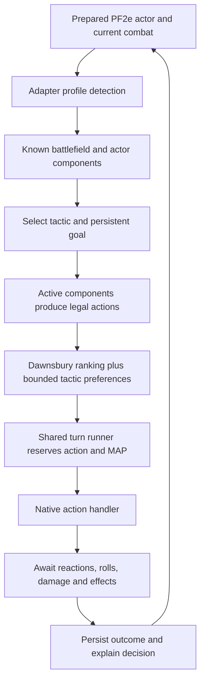

# Shared creature AI framework

Version **0.26.0** adds an ECS-style [plan and behavior layer](tactics-and-components.md) over the shared execution introduced in 0.9.0. Actors store attached component IDs and data; systems select a tactic and goal, activate its policy components, then rank supported legal actions. Creature kits bind native statistics and unique abilities. Imported descriptions remain creature data.

## Components

| Component | Responsibility |
| --- | --- |
| `framework/behavior-system.mjs` / `framework/tactical-behaviors.mjs` | Component/plan registries, persistent objectives, suitability, continuity, active policies, action gating and bounded score adjustments. |
| `foundry/behavior-runtime.mjs` | Actor/token configuration, observer-safe battlefield context, component lifecycle, revalidation, plan persistence and extension API. |
| `foundry/shared-stealth.mjs` | Shared Hide/Sneak execution, half-Speed/Swift Sneak, native observer checks and belief-safe Step updates. |
| `framework/strike-capability.mjs` / `foundry/native-strikes.mjs` | Reusable prepared Strike generation and native targeted-check/MAP/damage execution. |
| `profiles/basic-npc.mjs` / `foundry/basic-npc-adapter.mjs` | Basic recovery, perception, melee and ground movement bindings for an unfamiliar prepared NPC. |
| `framework/caster-planning.mjs` | Affordable remaining-turn casts/Strikes with one optional move; track MAP/slots, explain follow-ups, and replan after each executed action. |
| `framework/caster-defense.mjs` / `foundry/caster-stealth.mjs` | Protected casting positions, secret-result-independent Hide beliefs, bounded preparation/waiting and ranged-opponent exceptions. |
| `framework/caster-tactics.mjs` / `foundry/caster-target-knowledge.mjs` | Bounded melee pressure, role-aware movement control, own-HP slot conservation and combat-scoped visible-weapon memory. |
| `framework/spell-evaluation.mjs` | Spell attack/save/control estimates from encounter benchmarks, action budgets, limited slots, redundancy and friendly fire. |
| `profiles/goblin-pyro.mjs` / `foundry/goblin-pyro-adapter.mjs` | The first caster profile, torch fallback, casting positions and legal end-of-turn handling. |
| `foundry/spellcasting.mjs` / `foundry/spell-checks.mjs` | Native consumption, spell messages, spell attacks, defense rolls, damage and reaction interruptions. |
| `foundry/spell-areas.mjs` / `foundry/spell-zones.mjs` | Native Region geometry, bounded cone/Grease aiming, persistent slippery ground, spell effects and cleanup. |
| `foundry/goblin-scuttle.mjs` | Optional beneficial Goblin Scuttle Steps, shared reaction reservation and bounded chains after completed move actions. |
| `framework/registry.mjs` | Compose profiles from registered capability providers; reject unknown capabilities and preserve shared legality/budget checks. |
| `framework/turn-runner.mjs` | Action reservations, MAP, restricted movement pool, pending follow-ups, interruption handling, death recovery and optional advancement. |
| `framework/action-intent.mjs` | Natural-language descriptions of selected actions; no rule or scoring changes. |
| `foundry/ai-presentation.mjs` | Cancellable pre/post-action pauses, native token bubbles, private GM intent and managed NPC roll privacy. |
| `framework/math.mjs` | Check degrees, check probabilities and damage-formula estimates. |
| `profiles/scout-tactics.mjs` | Scout remaining-turn forecasts, known-threat exposure and bounded witnessed focus-fire preference. |
| `profiles/scout-group-tactics.mjs` / `foundry/scout-group.mjs` | Known ally support, initiative-sensitive isolation, bounded kite/swarm positioning and native future-move alternatives. |
| `framework/tactical-field.mjs` / `foundry/tactical-map.mjs` | Bounded obstacle/footprint-aware threat arrival, escape-space field, native geometry caching and recent movement memory. |
| `foundry/tactical-map-view.mjs` | Read-only GM rendering of the last calculated scout field. |
| `framework/navigation.mjs` | Bounded route search, reaction exposure states and enemy/exit flood distances. |
| `framework/recovery.mjs` | Shared Stand and Escape options. |
| `foundry/pf2e-adapter.mjs` | Common Foundry/PF2e state, movement, target eligibility, reaction waits, damage and reporting. The wolf subclass supplies its taught policy. |
| `foundry/combat-state.mjs` | Live incapacity/victory checks and creature occupancy: corpses, zero-HP and defeated tokens do not obstruct AI movement. |
| `foundry/creature-profiles.mjs` | Match prepared actors to implemented adapter profiles. |
| `profiles/ogre-boss.mjs` | Bruiser/leader capabilities: Strikes, Trip follow-up, command, equipment and movement. |
| `foundry/ogre-adapter.mjs` | Bind the ogre's declared attacks/inventory to native actions; handle its special abilities. |
| `foundry/command-effects.mjs` | Ogre-family identification and owned, timed movement-only Quickened effects. |

The old wolf turn-runner path remains a compatibility re-export. The wolf planner also re-exports shared math/navigation helpers for earlier integrations. Existing wolf action decisions, pack morale and pace preferences remain covered by regressions.

## Roles and encounter status

The ogre profile combines **bruiser** and **leader** capabilities with a **boss** encounter role. Its leader value comes from eligible allies who benefit from movement, rather than from a rule that it must shout every turn. The role label alone does not grant an action.

Wolf behavior remains specialized as a pack hunter. Version 0.12.0 adds a [Kobold Scout skulk](kobold-scout-foundry.md), with [scene environment regions](environment-zones.md), observer-relative stealth and native equipment costs. [Goblin Pyro](goblin-pyro-foundry.md) supplies the first taught caster; defender, support and other caster spell lists still need capability/profile combinations. Roles are not advertised as implemented merely because a role name exists. Elite/weak numerical adjustments continue to come from PF2e's prepared actor, not from another AI stat adjustment.

## Teaching a new JSON

1. Identify the actor's prepared attacks, footprint, inventory, traits and source identity.
2. Reuse supported capabilities with their actual costs, requirements, ranges and targets.
3. Implement missing special actions and reaction timing explicitly.
4. Define tactical preferences and optional pacing/morale separately from legality.
5. Add a small mechanics fixture plus meaningful action-sequence and native-integration tests.
6. Register its adapter/profile and expose unsupported additions for manual handling.

`CapabilityRegistry` composes providers returning uniquely identified candidates. The shared chooser validates legal flags, finite scores and affordable costs. A candidate consuming the command pool must be Step or Stride; neither a Strike nor a spell can spend that action. Profiles cannot return an unregistered capability.

`registerCreatureProfile({id, label, roles, matches, Adapter})` extends prepared-actor detection with an implemented adapter class. Duplicate registrations are rejected. Registration is code supplied by a module extension, not executable content extracted from an actor's description.

## Scope

The framework has eight specialized kits: Wolf, Ogre Boss, legacy Ogre, Kobold Scout, Goblin Pyro, Eagle, scorpion-tail Manticore and quill-tail Manticore. An unfamiliar NPC with valid prepared native melee Strikes can use the **Basic NPC** binding. It is not a universal stat-block interpreter or a complete PF2e rules engine. Native PF2e rolls resolve checks and damage; scoring remains an estimate. The basic binding lists untaught actions, ranged/ammunition configurations and spell lists for manual handling. Actors without a supported native binding are rejected.

The regular Ogre composes the shared recovery, Strike and movement providers with its own ammunition-preparation provider. Its adapter extends the ogre equipment/roll integration through hooks for primary weapon readiness, available attacks, range, ammunition consumption and per-Strike options. This supports the axe's native Sweep option and a finite Refuse supply without enabling boss-only capabilities. See [Ogre behavior](ogre-foundry.md).

Existing limitations still include full perception/special senses, arbitrary active Region behaviors, general spellcasting, arbitrary Quickened restrictions, commanded minions, Ready/Delay and many reaction types. Additional JSONs should expand actual handlers rather than silently bypass those requirements.

Since **0.10.3**, the declarative Define Surface behavior is supported through native path constraints. The generic active-Region guard only blocks other behaviors. Sight, ally support, physical attacks and Reactive Strike use native per-token ray origins with explicit elevation, plus native wall and surface collision tests. Prospective attack positions change horizontal coordinates without resetting ray height to ground level. Navigation still requires a shared elevation and level; this is not a multi-floor route planner.

Since **0.11.0**, the common adapter uses [per-observer known-square memory](target-memory.md). Sight loss preserves the last observed position, rather than following undetected coordinates. Movement can receive a bounded utility bonus for regaining a view. Version **0.12.0** adds scout Hide/Sneak; **0.18.0** adds [automatic Seek](npc-perception.md) to all four profiles, plus automatic targeting checks for located Hidden and Concealed enemies. Results affect one observer without deleting global stealth conditions. Point Out remains manual. The initial combat roster seeds known encounter squares, with explicit undetected/unnoticed/invisible or GM-hidden newcomers excluded; searching a chosen area can legitimately find an unknown creature actually in it.
