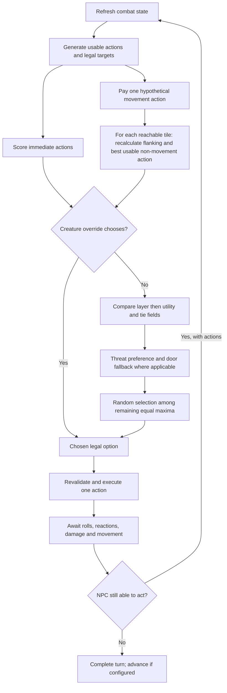

# Dawnsbury Days AI: recovered behavior and Foundry implementation

Inspected 2026-11-02. Module 0.5.0 replaces the earlier wolf heuristics with reconstructed behavior from **actual decompiled method bodies**. The [initial report](dawnsbury-ai-findings.md) only covered metadata and XML; it did not establish the formulas used below.

Version **0.6.0** adds explicit [Foundry maneuver adaptations](wolf-maneuvers.md): Step, Crawl, Escape, prone choices, physical attack paths and outcome-based remaster Knockdown valuation. The recovered comparator and basic Pack Attack evaluator remain unchanged; the new maneuver values are not claimed as extracted DD wolf formulas. Descriptions of initial remaster Knockdown priority below describe the 0.5.0 baseline.

The [additional findings](dawnsbury-ai-additional-findings.md), inspected 2026-11-03, cover follow-up attack valuation, route risk states, opening strategies, area targeting, scoring limitations and the game's decision log. These are research findings, not additional installed features.

Version **0.7.0** applies the wolf-relevant subset as [Knockdown setup scoring, reaction-aware route search and recorded decision explanations](wolf-decision-improvements.md). The exact recovered comparator and base attack evaluator remain unchanged. Other creature profiles, spell targeting and opening strategies are not implemented by this release.

## Source and reproducibility

- Assembly: `G:\SteamLibrary\steamapps\common\Dawnsbury Days\Data\Dawnsbury Days.dll`, version **4.44.0.0**.
- SHA-256: `61d48e6c059777a74b17e0fe4d9bc6600d57fbf6a09fe78e47cfdb7272304b23`.
- Decompiler: **ilspycmd 11.2.0.10050**, run locally against selected types with the adjacent Data folder as dependency search path.
- The game assembly was read statically. The game was not launched and its assembly was not loaded/executed by our research tool.
- Raw C# output is retained locally in ignored `.scratch/dawnsbury-decompiled`. It is not included in the Foundry module. The shipped implementation is newly written JavaScript describing the recovered decisions and explicit adaptations.

Representative command, from the workspace:

```powershell
& '.\.scratch\tools\ilspycmd.cmd' --disable-updatecheck `
  -r 'G:\SteamLibrary\steamapps\common\Dawnsbury Days\Data' `
  -t 'Dawnsbury.Core.Intelligence.AI' `
  -o '.scratch\dawnsbury-decompiled' `
  'G:\SteamLibrary\steamapps\common\Dawnsbury Days\Data\Dawnsbury Days.dll'
```

Repeat `-t` for `Dawnsbury.Core.Intelligence.AIUsefulnessComparer`, `Dawnsbury.Constants`, and `Dawnsbury.Core.Tiles.Tile` before running the local oracle verifier:

```powershell
node tools/verify-dawnsbury-policy.mjs
node --test
```

The verifier compiles the **decompiled comparer and attack-evaluation method**, plus the actual benchmark AC and tile-distance methods, in a separate scratch .NET project with small data stubs. It compares their outputs against the JavaScript implementation: **8,000 ranking pairs, 2,000 attack evaluations and 1,000 tile distances; zero mismatches**. The [verification record](../research/dawnsbury-behavior-verification.json) includes source hashes, input hash, seed and precise scope. The damage-finalization stub returns the proposed utility unchanged; it does not test the game's separate damage filtering. This is arithmetic/comparator parity, not an end-to-end game simulation or a Foundry live-world test.

## Methods traced

| Decompiled type | Members inspected and relevant result |
| --- | --- |
| `Dawnsbury.Core.Intelligence.AI` | `Decide`, `ChooseOption`, `CalculateTileGoodness`, `TakeAction`, `TakeActionAgainstTarget`, `ModifyGoodness`, `DealDamageWithAttack`, `DealDamage`, `KnockProne`, reaction preference |
| `Dawnsbury.Core.Intelligence.AIUsefulnessComparer` | `GetLayer` and `Compare`, including every comparison field |
| `Dawnsbury.Core.Intelligence.AIUsefulness` | Assessment fields, implicit numeric assessment, `Layer` |
| `Dawnsbury.Constants` | `GetStandardACPerLevel` |
| `Dawnsbury.Core.StatBlocks.Monsters.L1.Wolf` | Complete `CreateWolf` construction chain |
| `Dawnsbury.Core.Creatures.Creature` | `WithTactics`, `FriendOf`, movement request construction and action helpers |
| `Dawnsbury.Core.Mechanics.Rules.StrikeRules` | Strike construction and its inner utility based on damage formula plus effects |
| `Dawnsbury.Core.Mechanics.Core.CalculatedNumber` | `BonusNumberForAI` uses non-item bonus totals, rather than actual base defense |
| `Dawnsbury.Core.Mechanics.Targeting.Targets.CreatureTarget` | Target legality and modified inner goodness |
| `Dawnsbury.Core.CombatActions.CombatAction` | `WithGoodnessAgainstEnemy`, tile option construction and Step marker |
| `Dawnsbury.Core.Mechanics.QEffect` | `PackAttack`, `MonsterKnockdown`, Prone restrictions |
| `Dawnsbury.Core.Possibilities.Possibilities` | Stand priority, basic movement/action generation |
| `Dawnsbury.Core.Intelligence.Pathfinding` | Threatened-square marking, movement flood search, nearest-enemy flood distances |
| `Dawnsbury.Core.Tiles.Tile` | `DistanceTo(Tile)`, alternating-diagonal distance used for own movement ties |
| `Dawnsbury.Core.Coroutines.Options.*` | Combat action, tile and creature option wrappers |

This is a traced wolf-relevant subset, not an extraction of every monster, encounter script, spell or action in the game. Encounter scripts can alter constructed creatures; none were asserted to apply to the wolf baseline.

## Decision flow

The game uses a utility chooser with priority layers, rather than a single binary decision tree. Its rules engine generates usable actions and legal targets. Action/effect hooks provide values. The AI ranks those options; an optional creature override can select an option first.



The final execution/wait/ledger steps are Foundry integration. They preserve the previous safeguards around reaction pauses, interrupted actions and NPC death.

## Recovered ranking

For an option with main value `v`, priority increases as follows:

| Layer | Assignment |
| --- | --- |
| 1 | Negative usefulness, except the special fallback band |
| 2 | Zero usefulness without movement |
| 3 | Zero usefulness with movement that does not reduce nearest-enemy flood distance |
| 4 | Zero usefulness with movement that reduces that distance; also values within strictly less than 1 of `-1337` |
| 5 | Positive usefulness requiring movement, without the good-attacks flag |
| 6 | Positive usefulness without movement, or with movement and the good-attacks flag |

Values at least **5000** raise the resulting layer by one. Stand uses the high-priority sentinel `2^30`.

Options compare in this order, with later fields used only for exact ties:

1. Higher priority layer.
2. Higher main value.
3. No movement preferred.
4. At layers 1–4 only, smaller nearest-enemy distance. Reach users instead prefer a distance closer to two squares.
5. Shorter distance moved from the current square.
6. Step preferred.

The good-attacks flag for a projected move is true when the original state has **three actions**, or **two actions after at least one attack**. It is false with two actions and no attacks made, or with only one action. This explains the documented preference to preserve attacks; it is not an invented fixed sequence of two Strikes and one move.

Nearest-enemy distance comes from an eight-neighbor flood through traversable map edges. Own distance moved uses `Tile.DistanceTo`: larger coordinate difference plus half the smaller difference, rounded down. Neither measure includes terrain-adjusted movement cost. Foundry's native measured costs still control which destinations are reachable for one Stride.

Among equal maxima, a threatened one-square creature prefers nonprovoking options. If all maxima provoke, with three actions it may choose an equally valued, same-layer Step ending outside threat, even if the full comparator ranked that Step lower. If low-layer options do not approach an enemy, the original can choose an available Open Door action. Otherwise equal maxima are chosen randomly. Our shared chooser implements these supplied-option branches; the current wolf adapter does not generate Step or Open Door actions yet.

## Recovered attack and Pack Attack scores

For a normal attack, the base utility is:

```text
benchmark AC = standard AC for encounter CharacterLevel + non-item defense bonuses
estimated hit chance = clamp(21 + attack bonus - benchmark AC, 1, 20) / 20
attack value = inner damage-equivalent value * estimated hit chance
```

The inner Strike value comes from its prepared damage formula plus applicable effect adjustments. The evaluator uses **simplified hit probability**, without explicit critical-damage weighting. A concealment flat check multiplies this value by its pass probability. Mindless bypasses that calculation and uses half the inner value.

PackAttack then adds **2**, or **3.5** when at least three friendly creatures neighbor the defender. `FriendOf` includes the attacker itself, so the latter means the attacker plus at least **two other allies**. The bonus is a tactical preference; it is not the damage die. The actual PackAttack effect independently adds its configured die when that threshold is met.

The live wolf reconstruction uses the recovered tactical value and pack bonus, rather than adding arbitrary flanking or per-ally weights. Actual +1d4 damage remains the Foundry actor's Pack Attack rule. Base target AC is not read to pick a victim. Equal-valued targets can both win a tie; the AI does not promise an even spread of attacks and still prefers tactically stronger targets.

The standard AC table and evaluator are in `src/dawnsbury/chooser.mjs`. This intentionally reproduces DD's decision estimate; PF2e's actual degree-of-success rules still resolve native rolls. A correct game engine can have an approximate AI evaluation function.

## Wolf-specific findings and adaptations

The installed `Wolf.CreateWolf` constructs a level-1 wolf with the PackAttack tactic, its 1d4 PackAttack effect, and a jaws Strike. It does **not explicitly grant MonsterKnockdown, a Knockdown trait on jaws, or a wolf-specific OverrideDecision**. `WithTactics` sets the tactic field; it does not secretly add a wolf decision tree.

The generic `QEffect.MonsterKnockdown` elsewhere in DD gives an eligible legacy follow-up the high-priority sentinel and knocks the target prone without a roll. It costs one action, or zero for its improved form. DD's `AI.KnockProne` helper is different: it returns zero for an already-prone target, otherwise the acting creature's level with a minimum of one.

Your exported Foundry Monster Core wolf **does have Knockdown**. That ability remains supported and costs one action. Its existing legacy/remaster marker determines whether the adapter applies Prone directly or rolls the remaster Trip without applying/increasing MAP. Borrowing DD's generic legacy Knockdown priority for this Foundry ability is an explicit adaptation, **not a recovered wolf-specific instruction or a remaster Trip utility model**. Already-prone, immune, out-of-reach and otherwise ineligible targets are excluded as required by our supported rules and your requested behavior.

| Behavior | Recovered baseline or Foundry adaptation? |
| --- | --- |
| Layer/comparison formula, simplified hit chance, pack preference, AC table | Recovered; direct oracle comparison |
| One-action movement lookahead and good-attacks flag | Recovered; implemented over supported wolf actions |
| Stand priority | Recovered from basic action generation |
| Pack Attack's two-other-allies threshold | Recovered and matched to the Foundry actor's rule |
| Knockdown priority for this Foundry wolf | Adapted from generic DD legacy MonsterKnockdown |
| Encounter level | Adaptation: rounded mean level of character combatants, fallback NPC level; Foundry has no DD CharacterLevel field |
| Defense adjustments for planning | Adaptation limited to Prone, Off-Guard and flanking; other non-item defense modifiers are not reconstructed yet |
| Map distances | Eight-neighbor, wall-aware flood; bounded to 20,000 expanded cells; no DD door/squeezing special cases |
| Movement execution/cost, occupied squares, diagonal parity | Foundry native measurement and conservative supported occupancy rules |
| Avoid revisiting previous movement destinations in a turn | Retained Foundry guard against movement loops; not claimed as DD behavior |
| Player reaction ownership, waiting, reaction ledger, death/turn passing | Foundry integration, not a copied DD subsystem |
| Neutral/manual versus opposing-alliance targeting | User-requested Foundry policy |

## Current boundary

The shared decision machinery is reusable. Other enemies still need action generators, effect valuations and execution handlers. Their stat blocks and special overrides must be inspected separately; the illustrative dragon and mindless JSON profiles have not become extracted monster AIs.

DD's PF2e legality is distributed across its action, targeting, effect, movement and check implementations. Those systems cannot be transferred by copying `AI.Decide`. Foundry's PF2e system supplies rolls and effects through the adapter. Unsupported conditions/actions still require manual handling. Current decision scores do not reproduce every situational bonus, cover calculation, damage resistance or special effect in DD. This build has automated integration tests but still needs live Foundry-world verification after clients reload.

Version 0.5.1 corrects an adapter restriction outside the recovered chooser: allies no longer block the path search. Traversal and stopping now use separate predicates. The wolf can pass through allied creatures at the normal measured cost, but each proposed Stride ends in a clear square. This follows the willing-creature passage rule in [Player Core p. 422](https://2e.aonprd.com/Rules.aspx?ID=2360); the adapter assumes same-alliance creatures are willing. Other occupancy exceptions and multi-action plans that temporarily end one move in an ally's square are not implemented by this fix.
