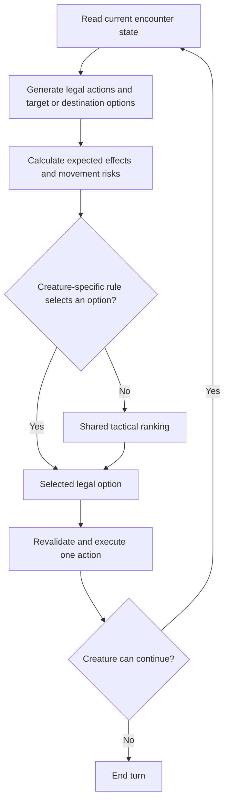

# Dawnsbury Days NPC AI extraction — initial metadata report

**Historical report, through module 0.4.1.** Method bodies have since been decompiled and inspected. The current findings, recovered algorithms, verification results, and Foundry adaptations are in [the behavioral extraction report](dawnsbury-ai-behavior.md). Statements below about missing bodies/formulas describe the earlier investigation, not the current 0.5.0 implementation.

Inspected 2026-11-02. This document separates observed interfaces and documented behavior from the independent Foundry implementation proposal.

This is the initial extraction report. The subsequent [wolf adapter and setup guide](wolf-foundry.md) describe the implemented Foundry baseline and its remaining live-verification requirements.

## Evidence and scope

| Source | Inspected result |
| --- | --- |
| `G:\SteamLibrary\steamapps\common\Dawnsbury Days\Data\Dawnsbury Days.dll` | Assembly version 4.44.0.0; public metadata read without executing the assembly |
| Adjacent `Dawnsbury Days.xml` | Documented tactic behavior and scoring/override extension points |
| `CustomMods\README.md` | Architecture and author-provided reuse terms |
| Example Scarecrow mod | Creature construction and effects; no custom AI policy in this example |
| `C:\Users\Roman\AppData\Local\FoundryVTT\Data\systems\pf2e\system.json` | Installed PF2e 8.6.1; declared Foundry minimum 14.361, verified 14.369 |

The [machine-readable inventory](../research/dawnsbury-api-inventory.json) records the assembly SHA-256 and 11 named Intelligence types, their public methods/fields, literal constants, and 15 documented member references. Parameter names are recorded, not complete type signatures. The XML includes only documented members, so that list is not a complete API inventory. Some referenced methods appear in XML cross-references without their own documentation entries.

No method bodies, runtime traces, constructor defaults, complete per-monster policies, or private state were extracted. Method and constant names expose structure; they do not establish the exact calculations or branch conditions.

Public source: [author's modding repository](https://github.com/dawnsbury/dawnsbury-days-example-mods#dawnsbury-days-solution-architecture). Local API documentation is the more precise source for the installed build.

## Confirmed architecture

The author describes per-creature option evaluation followed by selection of the most useful option. The installed metadata additionally exposes a specialized comparator and priority-layer constants. This is evidence for a layered utility architecture with policy overrides, rather than one universal binary decision tree.

| Component | Confirmed interface or documentation | Foundry counterpart proposed here |
| --- | --- | --- |
| Creature policy | `AI.Tactic`, `AI.OverrideDecision` | Shared profile plus ordered creature-specific decision rules |
| Decision entry | `AI.Decide(request)` | `decide(snapshot, profile)` |
| Action execution | `AI.TakeAction(action, selectedActionCost)` | Separate adapter executes one choice and then rebuilds state |
| Option ranking | `AIUsefulness`, `AIUsefulnessComparer.GetLayer/Compare` | Rule priority, then utility, then explicit fallback; deliberately simplified |
| Movement valuation | `AI.CalculateTileGoodness`; `AIUsefulness.RequiresMovement`, `DistanceFromYou`, `DistanceFromClosestEnemy` | Evaluate reachable destinations and subsequent attack opportunities |
| Movement risk | `GraphState`, `TileVertex`, `Pathfinding` | Path costs, reactions, hazards, occupied spaces, and traversal requirements |
| Expected effects | `AI.DealDamageWithAttack`, `DealDamageWithBasicSave`, `DealDamage`, `Heal` | PF2e outcome model; not implemented in the prototype |
| Status effects | `Fear`, `Slow`, `Stun`, `KnockProne`, `Restrain`, `Blind`, and others | Explicit effect evaluators and immunity checks |
| Areas | `DetermineAreaValue`; target center-point valuation hooks | Score each candidate area using affected creatures and ally risk |
| Reactions | `ShouldTakeAttackOfOpportunityAgainst` | Separate event-triggered reaction policy |
| Special strategies | `CommonAIStrategies.CreateAndApplyBuffingStrategy`, `FindAction`, `FindSpell` | Scripted opening sequences and ability selectors |

Expected-damage and effect valuation are suggested by method names and parameter names, including `expectedDamageOnHit` and `howMuchDamageEquivalent`. Their exact arithmetic and relative scales remain unverified.

## Baseline tactics

The installed XML documents:

| Tactic | Documented behavior | Evidence |
| --- | --- | --- |
| Standard | Evaluate actions; favor two attacks and one movement; exploit flanking | XML member `F:Dawnsbury.Core.Intelligence.Tactic.Standard`, around line 4022 |
| Mindless | Advance toward the nearest enemy and Strike it | Same namespace, `Tactic.Mindless`, around line 4027 |
| PackAttack | Standard behavior with a preference for engaging enemies also within allies' reach | `Tactic.PackAttack`, around line 4032 |

The enum also contains `DoNothing` and `PanickingChild`. Only the names and values were verified; their implementations have not been inspected. Do not infer panic, morale, or civilian behavior from those names alone.

The Standard description is a preference, not a prescribed three-action sequence for every turn. The prototype does not yet model the two-attacks/one-move preference or compare complete action sequences.

## Priority layers and special values

`AIUsefulnessComparer` exposes these named layers in ascending numeric order:

| Value | Public constant |
| --- | --- |
| 1 | `LAYER_ONE_FLOOR` |
| 2 | `LAYER_TWO_USEFULNESS_ZERO` |
| 3 | `LAYER_THREE_A_USEFULNESS_ZERO_AND_STEPS_IN_WRONG_DIRECTION` |
| 4 | `LAYER_THREE_B_USEFULNESS_ZERO_AND_REQUIRES_MOVEMENT` |
| 5 | `LAYER_FOUR_USEFUL` |
| 6 | `LAYER_FIVE_USEFUL_REQUIRES_NO_MOVEMENT_OR_YOU_HAVE_GOOD_ATTACKS_LEFT` |

`AIUsefulness` contains a main usefulness value, movement indicators, distance information, an objective action, and a `Layer` property. The names indicate that movement and remaining attack opportunities participate in ranking. **The exact layer assignment and tie-breaking rules cannot be recovered from metadata alone.** Numeric ordering does not by itself prove comparator precedence.

`AIConstants` also exposes sentinel and priority values such as `NEVER`, `BASICALLY_NEVER`, `VERY_PREFERRED`, `EXTREMELY_PREFERRED`, `ALWAYS`, `IMPROVE_LAYER_THRESHOLD`, and `SPECIAL_DO_THIS_IF_NOTHING_ELSE`. Their actual literal values are in the inventory. The last constant's XML documentation describes an action used instead of purposeless stepping. These constants are research observations; the independent engine does not import their values.

## Where individual enemy decisions belong

The XML for `AI.OverrideDecision` says it receives the calculated option set and may choose an option; returning null preserves normal ranking. Other hooks adjust usefulness on effects, spell variants, individual targets, or area centers.

This supports a reusable architecture:

This diagram is the proposed Foundry adaptation of the observed architecture, not a recovered control-flow graph of Dawnsbury's implementation.

An enemy profile should contain its baseline tactic, supported ability handlers, special decision rules, and encounter-specific instructions. For example, an independently authored wolf policy can prioritize a legal knockdown follow-up, then reuse Pack targeting. A dragon policy can prefer an available breath weapon when multiple enemies and no allies occupy a legal area, then return to normal ranking. Neither example is a claim about Dawnsbury's implementation of those creatures.

## Foundry integration boundary

The current prototype is system-independent. The following pieces are required before any creature can take a live Foundry turn:

1. A PF2e adapter reads the active token, actor, encounter, action budget, conditions, effects, and observed enemies. Keep perceived knowledge separate from GM-visible actor data, including hidden enemies and undiscovered weaknesses.
2. An action registry enumerates supported Strikes, movement options, basic actions, spells, and named abilities. Arbitrary descriptive text is not an executable ability. Unsupported mechanics must be surfaced instead of silently treated as a generic attack.
3. A rules-aware validator checks reach/range, line of effect, visibility, immunities, resource availability, action costs, and ability prerequisites. Movement must consider token footprint, walls, occupied spaces, diagonal costs, difficult terrain, elevation, hazards, and reaction exposure.
4. An outcome model calculates PF2e degrees of success, natural 1/20 adjustments, current multiple attack penalty, damage, relevant resistances/weaknesses, healing caps, and effect durations. Unknown defenses require an explicit knowledge policy.
5. A turn runner executes through the installed PF2e system APIs, updates its own reliable action/MAP/resource ledger where necessary, waits for rolls and reactions, and rebuilds options after each resolved action. Do not assume Foundry enforces or spends every action automatically.
6. A GM interface assigns profiles and shows the selected action with its explanation. Automatic execution needs an explicit per-creature setting, one designated GM authority, cancellation, turn-change checks, and a repeated-state guard against zero-cost loops.

PF2e 8.6.1's installed bundle exposes `ActorPF2e`, `NPCPF2e`, and `rollActionMacro`. Public API behavior still needs version-specific integration checks in a running Foundry session. Installation metadata alone does not demonstrate that a particular macro signature or action runner works.

No module was installed, no live Foundry session was accessed, and no tokens, actors, or worlds were modified.

## Reuse boundary

The author's [published reuse terms](https://github.com/dawnsbury/dawnsbury-days-example-mods#licensing) distinguish example-mod code from base-game code and explicitly permit decompiled-code reuse for Dawnsbury mods. Those terms do not provide a Foundry port license for the base game. This project therefore records public interface metadata and independently implements the documented architectural approach. Copying base-game implementation into a distributed Foundry module would require resolving those rights separately.

## Verification and remaining extraction work

The metadata extractor built and ran against the installed DLL. Seven Node tests cover profile differences, illegal/unknown/expensive action exclusion even under overrides, rule fallthrough, nearest-enemy targeting, fallback behavior, state changes, deterministic ties, and malformed input.

The prototype uses newly authored linear feature weights. It has not reproduced the six-layer comparator, complete turn planning, or exact per-enemy AI. Metadata extraction is complete for the selected namespace; behavioral extraction remains incomplete. Useful next evidence would be action-choice traces gathered inside Dawnsbury across controlled scenarios, especially first/second/third attacks, movement versus attacks, pack positioning, healing, areas, and reaction use. Such traces can distinguish the observed game policy from our approximation without copying game implementation.

The first Foundry implementation should use one creature and a small, explicit action set. A wolf provides a focused Pack test, a zombie a Mindless test, and a goblin warrior a Standard test. Expand the action registry as each additional creature requires it.
