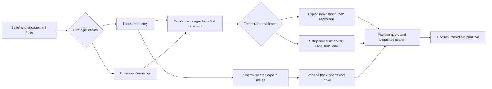

# Hierarchical combat decision architecture research

Date: 2026-11-26

Status: research and architectural recommendation. This document deliberately does not change runtime behavior.

Related work:

- [Combat planning research](./combat-planning-research-2026-11-26.md)
- [Six-action tactical planner design](./six-action-tactical-planner-design.md)
- [Decision debugger](./decision-debugger.md)
- [Implementation blueprint](./hierarchical-decision-graph-design.md)

## Conclusion

The current debugger accurately exposes the current engine, but the current engine is shallow. It first picks one tactical plan from a flat list, activates components, and then ranks one-action candidates. Rendering more boxes between those steps would only make the mock-up taller.

The replacement should be a **hierarchical, utility-guided, receding-horizon planner**:

1. mandatory PF2e directives constrain the search;
2. a belief-state and engagement analysis describe the combat;
3. doctrine and encounter needs generate several strategic hypotheses;
4. each hypothesis binds an intended target or group and a desired combat end-state;
5. the planner compares exploiting now, setting up this turn, setting up next turn, holding, and disengaging;
6. an HTN-like library decomposes each surviving hypothesis into indivisible activities and primitive actions;
7. a bounded six-action search grounds exact squares, attacks, spells, and responses;
8. a reactive executor validates the next primitive action and repairs only the lowest invalid part of the plan.

The decision visualization should therefore be an **AND/OR decision DAG plus a temporal plan view**, generated from a recorded planning trace. It should show several hypotheses surviving multiple layers, shared facts feeding many hypotheses, compound tasks requiring all children, alternative methods, pruned branches, simulated consequences, and the selected immediate action. A root with many scored leaves is useful as an action-ranking report; it is not a planning graph.

## What the present graph reveals

The current [decision graph builder](../src/foundry/decision-graph.mjs) records this pipeline:

```text
situation
  -> plan ranking
     -> preferred / backup / desperate labels
        -> one selected plan
           -> one objective
              -> behavior components
                 -> action ranking
                    -> candidate actions
                       -> score terms
```

The engine behind it has the same shape:

- [behavior-system.mjs](../src/framework/behavior-system.mjs) evaluates every configured tactical plan in one list and selects one;
- the selected plan activates a collection of behavior components;
- [decision-engine.mjs](../src/framework/decision-engine.mjs) ranks the resulting immediate candidates;
- [tactical-behaviors.mjs](../src/framework/tactical-behaviors.mjs) places roles, delivery styles, risk postures, movement policies, and encounter states in the same plan catalogue.

This creates four structural problems.

### Different kinds of knowledge compete as if they were actions

“Ranged,” “supporting,” “hiding,” “charge,” and “aerial” do not answer the same question. Ranged is a delivery mode, supporting is a combat contribution, hiding is an end-state or method, charge is a temporal commitment, and aerial is a mobility context. Picking exactly one discards useful combinations before the engine has formed a concrete course of action.

### A greedy early choice erases viable continuations

Only the selected plan reaches the action layer. A slightly lower-scoring support plan might decompose into a decisive two-action spell, while the winning generic ranged plan might offer only a poor third-range-increment Strike. The current structure cannot discover that because it compares abstract labels before it compares their complete consequences.

### Candidate scores contain no causal plan

An immediate Stride may score well because it approaches a target, but the record does not say what that Stride enables, which future activity consumes the remaining actions, or what position the actor intends to occupy next turn. This is why movement can appear aimless even when every local score term is individually reasonable.

### The renderer has no hierarchy to display

The debugger could invent nodes called “role,” “range,” and “setup,” but those decisions do not currently exist in the runtime trace. A trustworthy debugger must visualize recorded reasoning. The planner must gain real intermediate representations before the graph can show them.

## Findings from game-AI research

### Hierarchy should refine a problem, not merely categorize an actor

Hai Hoang, Stephen Lee-Urban, and Héctor Muñoz-Avila describe HTN planning as repeated decomposition of compound tasks into simpler tasks until primitive in-game actions remain. Methods carry preconditions and subtasks, so alternative strategies arise from the current state rather than from a fixed transition chain. [Hierarchical Plan Representations for Encoding Strategic Game AI](https://cdn.aaai.org/ojs/18717/18717-52-22353-1-10-20210928.pdf)

Humphreys makes the practical distinction especially useful here: an HTN begins with a high-level problem, recursively decomposes it, and ends with an ordered series of atomic tasks. Unlike a behavior tree that only reacts to the present, the planner can reason about the effects of proposed actions. [Exploring HTN Planners through Example](https://www.gameaipro.com/GameAIPro/GameAIPro_Chapter12_Exploring_HTN_Planners_through_Example.pdf)

For this project, “deal ranged damage to the fighter while ending outside its one-turn melee threat” is a compound task. “Stride to grid square 18,12” and “cast a two-action spell” are primitive actions. “Ranged creature” is neither; it is a capability fact used by methods.

### Strategic planning and reactive execution should remain separate

Neufeld, Mostaghim, and Brand combine HTN planning for high-level strategy with behavior trees for low-level execution. Their key observation is that a blocked path may invalidate one low-level method without invalidating the overall group attack. Only failure of all reactive execution alternatives should propagate upward and trigger high-level replanning. [A Hybrid Approach to Planning and Execution in Dynamic Environments](https://ojs.aaai.org/index.php/AIIDE/article/download/13044/12892/16561)

That maps directly to Foundry. A native movement constraint, reaction, failed flat check, newly prone target, or occupied destination should first repair the current primitive or method. It should not immediately forget the intended target, formation, spell setup, or encounter role.

### Long plans need multiple scenarios and selective replanning

Namiki and colleagues identify a failure mode of ordinary HTNs in changing games: frequent total replanning collapses long-term behavior back into short reactive behavior. Their ART-HTN separates a simulation planner, a multi-scenario plan, and a plan executor, using an abstract game model rather than the full 3D world for every simulation. [Advanced Real-Time Hierarchical Task Network](https://cdn.aaai.org/ojs/18910/18910-52-22676-1-2-20211004.pdf)

The implication is not to commit to one brittle six-action script. The AI should retain a small scenario set, such as:

- the target closes;
- the target holds position;
- the target retreats or breaks line of sight;
- a key save succeeds or fails.

One selected plan can have conditional continuation points without multiplying every die result into a full game tree.

### Utility belongs inside the hierarchy

Merrill shows why behavior-tree structure and utility selection complement each other: the tree provides readable decomposition and execution, while utility handles analog tradeoffs among several reasonable branches. [Building Utility Decisions into Your Existing Behavior Tree](https://www.gameaipro.com/GameAIPro/GameAIPro_Chapter10_Building_Utility_Decisions_into_Your_Existing_Behavior_Tree.pdf)

Hanlon and Watts describe Dragon Age: Inquisition's Behavior Decision System as enumeration of legal actions followed by utility evaluation, while also calling out the future opportunity cost of spending limited resources. [Behavior Decision System](https://www.gameaipro.com/GameAIPro3/GameAIPro3_Chapter31_Behavior_Decision_System_Dragon_Age_Inquisition%E2%80%99s_Utility_Scoring_Architecture.pdf)

The lesson is to retain utility scoring, but move it to the correct decisions:

- rank strategic hypotheses with coarse estimates;
- rank decomposition methods with method-specific evidence;
- rank grounded sequences by simulated end-state value;
- rank equivalent immediate executions only after their future purpose is known.

### Perception and world knowledge are inputs, not hidden omniscience

The Killzone 3 architecture separates perception and state-maintaining daemons from planning. The individual bot receives an order but remains free to choose target, position, and weapon, and its world database can be believably wrong because perception is limited. [Hierarchical AI for Multiplayer Bots in Killzone 3](https://www.gameaipro.com/GameAIPro/GameAIPro_Chapter29_Hierarchical_AI_for_Multiplayer_Bots_in_Killzone_3.pdf)

This supports the existing project rule that secret Stealth outcomes must not leak into AI decisions. The planner operates on a belief state with confidence and remembered positions. The debugger may show the AI's belief, but not the GM's hidden truth as if the actor knew it.

### Spatial reasoning should be queried in context

Jack's tactical-position system begins with behavior context, selects a context-specific spatial query, generates points, filters invalid points, scores survivors, and returns failure to the high-level behavior when no point satisfies the query. [Tactical Position Selection](https://www.gameaipro.com/GameAIPro/GameAIPro_Chapter26_Tactical_Position_Selection.pdf)

Mark's modular influence maps combine spatial channels for threat, safe withdrawal, tank positioning, enemy clusters, blocking spells, and ally spacing. [Modular Tactical Influence Maps](https://www.gameaipro.com/GameAIPro2/GameAIPro2_Chapter30_Modular_Tactical_Influence_Maps.pdf)

This means there should not be one universal heat-map score. The selected engagement hypothesis defines a spatial query. A ranged damage hypothesis asks for first-increment line of effect, escape capacity, and distance from melee threats. A support hypothesis asks for ally coverage and safety. A controller asks for area geometry and future movement denial.

### Team hierarchy should delegate rather than micromanage

The Killzone hierarchy translates commander objectives into squad orders, while individuals choose how to execute those orders. SquadSmart similarly uses a shared knowledge base and HTN decomposition to coordinate several actors, with explicit synchronization and a planner that can pause and resume under a frame budget. [SquadSmart](https://cdn.aaai.org/ojs/18775/18775-52-22468-1-10-20210929.pdf)

For PF2e, an encounter coordinator can eventually publish needs such as “screen the caster,” “focus the isolated target,” or “reserve one reaction.” It should not prescribe each square and attack. Individual planners should bid for those needs according to their capabilities, then ground their own legal sequences.

## Architectures considered

| Architecture | Strength | Failure if used alone here | Use in the recommendation |
| --- | --- | --- | --- |
| Flat utility AI | Fast, data-driven comparison of many choices | Greedy immediate actions; unrelated concepts become peers | Scores alternatives at several hierarchy levels |
| Behavior tree | Clear reactive execution and failure handling | Weak future-state reasoning; large authored trees become rigid | Executes and locally repairs primitive tasks |
| GOAP | Finds action sequences from preconditions and effects | Large grounding space; difficult PF2e activity and spatial branching | Operator model and effect simulation ideas |
| HTN | Natural abstraction, activity bundles, domain knowledge, readable plans | Authored method order can be brittle; plain HTN handles uncertainty poorly | Main decomposition structure |
| MCTS/game-tree search | Explicit opponent responses and uncertainty | Branching cost is too high for all PF2e actions and grid cells | Small abstract response model after pruning |
| Influence/position queries | Strong spatial choices and reusable attractors/repellers | Cannot decide strategic purpose by itself | Grounds destinations for a chosen hypothesis |
| Hierarchical FSM | Easy stable modes and interrupts | Transition growth and weak novel sequencing | Only for a few durable executor states |

No single architecture solves the project. The correct combination is HTN-like decomposition, utility-guided top-K selection, bounded forward simulation, context-specific spatial queries, and reactive execution.

## The proposed abstraction hierarchy

The layers below are semantic layers. They need not each consume a frame or force exactly one winner.

### Layer 0: mandatory directives and legality

Purpose: establish what the actor is compelled or permitted to do.

Examples:

- dead, defeated, incapacitated, restrained, grabbed, prone;
- Fleeing, Confused, and Controlled using the project's adjudication order;
- action and reaction availability;
- polymorph, spellcasting, manipulate, movement-mode, and resource restrictions;
- encounter victory or no valid opposition.

This layer prunes illegal families and may install a mandatory top-level task. It is not a utility contest. A compelled Flee task cannot lose to a high-damage spell.

### Layer 1: capability and doctrine profile

Purpose: describe what the creature is good at and how strongly each contribution applies.

This is a multi-label vector, not a single class:

```text
contribution: damage 0.8, control 0.7, support 0.2, defense 0.4
delivery: melee 0.5, ranged 0.9, area 0.7
mobility: ground 0.4, flight 1.0
survivability: durable 0.5, evasive 0.8
doctrine: skirmisher 0.9, ambusher 0.6
```

Values derive from the statblock, spell and activity components, configured personality, encounter role, remaining resources, and observed effectiveness. This layer changes slowly and should be cached.

### Layer 2: belief-state and engagement analysis

Purpose: calculate facts needed by every later hypothesis.

For every actor-target pair, record an engagement relation:

```text
can affect now / after 1 / 2 / 3 actions
expected effect by delivery mode
can be affected by target now / after one target turn
known, observed, hidden, undetected, remembered
line of sight, line of effect, cover, concealment
range increment or melee reach
path cost and reaction exposure
save and defense matchup confidence
ally support and interference
```

This is the concrete version of “what targets can I engage, and what targets can engage me?” It produces a relationship graph and spatial fields. It does not select a target.

### Layer 3: strategic intent hypotheses

Purpose: decide which broad encounter contributions are currently valuable.

Examples:

- pressure enemy health;
- control enemy actions or terrain;
- protect or recover an ally;
- survive and preserve a scarce resource;
- deny an objective or delay pursuit;
- withdraw because the pack has lost;
- investigate an uncertain enemy position.

Each hypothesis combines creature doctrine with current encounter need. The planner retains the best few hypotheses within a score band instead of choosing one immediately.

### Layer 4: engagement hypotheses

Purpose: turn intent into a falsifiable desired combat state.

An engagement hypothesis is a tuple:

```text
(intent, delivery mode, subject target/group, desired end-state, horizon)
```

Examples:

- damage + ranged spell + fighter + first increment with line of effect and outside one-turn melee threat + this turn;
- control + area spell + three enemies + block their route without catching allies + this turn;
- support + defensive spell + allied bruiser + buff active before the enemy focus turn + this turn;
- pressure + melee + isolated enemy + flanked and grabbed + next turn.

This layer prevents target selection from being separated from the way and reason the target will be engaged.

### Layer 5: temporal commitment

Purpose: compare when to realize the engagement.

Each engagement can branch into:

- **exploit now**: payoff is available without setup;
- **setup then exploit this turn**: one-action setup enables a two-action payoff;
- **setup for next turn**: the expected retained advantage exceeds the opportunity cost and disruption risk;
- **hold or observe**: acting now exposes the creature or wastes a limited resource;
- **disengage or switch**: the intended engagement is strategically poor.

This is the correct home for “shoot now or set up a shot?” The alternatives are compared as complete sequences, including the value of the final state, the probability that setup survives, and the value lost by waiting.

### Layer 6: tactical objective and position query

Purpose: define the attractors, repellers, hard filters, and success conditions for spatial grounding.

Examples:

- remain in the first range increment;
- have line of effect to the selected target;
- end outside the predicted one-turn melee envelope;
- stay within one Stride of allied support;
- gain cover from the target while retaining a firing lane;
- avoid corners, pits, hazardous terrain, reaction reach, and ally congestion;
- include at least two enemies and no allies in a burst;
- preserve enough Fly movement to finish above melee reach.

The query can return several promising regions or points. Failure is a reason to try another method or engagement, not permission to pick an arbitrary closest square.

### Layer 7: compound task decomposition

Purpose: expand a tactical objective into valid activity bundles.

Example methods for `establish-ranged-pressure`:

```text
if attack is useful now:
  [ranged-payoff, reposition-or-defend]

if one-action movement enables a two-action spell:
  [move-to-casting-position, cast-spell]

if next-turn setup is defensible:
  [take-cover, hide-or-defend, reserve-next-turn-payoff]

if threatened in melee:
  [disengage, switch-to-ranged-payoff]
  or [switch-to-melee-backup]
```

Two- and three-action activities remain atomic. The planner cannot place half a spell on each side of a turn boundary.

### Layer 8: grounded sequence search

Purpose: bind exact actions, squares, targets, spells, weapons, and resource choices.

Use bounded beam search over the current turn, a small abstract opponent response, and the actor's next turn. Search should:

- retain several prefixes rather than one greedy prefix;
- merge equivalent states;
- cache geometry and relationship queries;
- prune dominated sequences;
- use cheap coarse scores before expensive native validation;
- evaluate terminal combat states as well as immediate effects.

This layer produces complete candidate timelines such as:

```text
Turn N: Stride to P -> cast two-action spell at T
Response: T closes one Stride and attacks
Turn N+1: Step -> cast two-action control spell
```

### Layer 9: immediate choice and reactive execution

Purpose: execute only the next primitive action through the PF2e system and Foundry.

Before execution, revalidate native legality and current assumptions. On a change:

1. try an equivalent primitive binding;
2. try another method under the same tactical objective;
3. try another engagement under the same strategic intent;
4. only then select a new strategic intent.

### Layer 10: monitoring and learning signal

Purpose: explain success or failure and improve future rankings without leaking hidden information.

Record:

- predicted versus actual end state;
- method failure reason;
- setup retained or disrupted;
- resource efficiency;
- whether an ally completed the coordinated payoff;
- whether the plan repeated an equivalent failed state.

Initially these are debugger evidence and deterministic tuning inputs. They do not require machine learning.

## Why role and range should not be consecutive hard gates

The proposed “damage or support, then ranged or close” ordering is a useful human checklist, but a poor exclusive tree:

- a vampire mastermind can contribute damage, control, and support in the same combat;
- a dragon can be ranged until an opening makes melee worthwhile;
- a tank may be most useful at range when guarding a chokepoint;
- a short-range caster is both ranged and threatened by melee engagement;
- a skulk can support through Point Out while preparing its own attack.

A hard role choice followed by a hard range choice creates a taxonomy. A planner needs composable facts and a hierarchy of **commitments**. Therefore role and delivery feed the creation of engagement hypotheses; they are visible in the graph, but they do not each discard every other branch.

## The graph should be a decision DAG

The target structure is a directed acyclic graph because several branches reuse the same evidence and subproblems.

### Node types

| Node | Meaning | Examples |
| --- | --- | --- |
| Fact | Believed world or capability datum | target hidden, first increment 60 ft, ally at 20% HP |
| Constraint | Mandatory or legal gate | Confused, activity needs two actions, no line of effect |
| OR decision | Choose one or retain top K alternatives | intent, engagement, decomposition method |
| AND task | All ordered children are required | move then cast; flank then Strike |
| Query | Generate/filter/score bindings | safe casting squares, burst centers |
| Simulation state | Predicted state after a prefix or response | target prone, caster exposed, slot spent |
| Primitive | Executable PF2e action or activity | Step, Eagle Dive, 2-action spell |
| Outcome | Terminal evaluation or repair result | chosen sequence, dominated, native failure |

### Edge types

Edges must state their semantics:

- `supports` from facts to hypotheses;
- `forbids` from constraints to pruned branches;
- `refines` from intent to engagement;
- `decomposes-all` from an AND task to required children;
- `alternative-method` from an OR decision to methods;
- `binds` from a query to a square, target, or activity;
- `simulates` from a primitive to a future state;
- `responds-with` for the opponent abstraction;
- `selected`, `survived`, `pruned`, `failed`, and `repaired` for search status.

### Several branches must continue

The graph should show the top few strategic and engagement hypotheses continuing into methods. Branches disappear only for a recorded reason:

- illegal;
- dominated by a cheaper equivalent;
- below the beam threshold;
- over the computation budget;
- method precondition failed;
- native validation failed;
- final utility was lower.

This makes the debugger answer “what did it consider?” and “where did it stop considering it?” rather than only “what won the last score?”

## Worked example: ranged skulk

Assume a kobold has a ranged Strike, shortsword, Hide, Sneak, cover nearby, and one large melee enemy approaching.



The same “preserve skirmisher” fact supports a ranged setup and can penalize a melee swarm. The ranged plan does not win merely because the actor was labeled ranged; the complete end state must be better. Hide is penalized if the creature already believes it is hidden, and Sneak is valuable only when undetected defense or relocation contributes to the selected end state.

## Worked example: short-range caster

Assume a caster can cast Grease, an offensive two-action spell, and a defensive spell while enemies are two turns away.

Candidate engagements:

1. control the approach with Grease, ending in concealment;
2. hold a short-range damage spell until the enemy enters a strong range band;
3. advance and cast now;
4. defend an ally that will receive the first charge.

The temporal layer can value preparation without inventing idle behavior. The six-action evaluator compares expected damage/control after the opponent response, caster exposure, resource opportunity cost, and the probability the setup remains useful. It can choose Grease plus concealment now, then a damage spell next turn, because that complete branch beats walking into threat range for an immediate weak cast.

## Failure modes to avoid

### Decorative hierarchy

Adding labels above an unchanged flat action score is a visualization change, not an AI change. Each displayed decision must be recorded by the runtime with alternatives and reasons.

### Premature single winners

Choosing exactly one role, target, or method at every layer recreates the greedy problem at a higher altitude. Retain top K candidates or every candidate within a utility band until grounded consequences distinguish them.

### Combinatorial cross-products

Do not enumerate every role × delivery × target × position × action sequence. Capability filters, engagement reachability, method preconditions, position regions, dominance rules, and beam limits must progressively narrow the search.

### Mixing truth with belief

Predicted target behavior and hidden-state confidence belong in the actor's belief model. Debug display must distinguish believed, inferred, remembered, and GM-known facts.

### Replanning from the root on every disturbance

Local execution failure should repair the lowest invalid layer. Otherwise multi-turn planning degrades into the current one-action loop.

### One universal position score

Cover, distance, flank, altitude, spell geometry, ally spacing, and escape capacity have different importance under different objectives. Use named query templates with explicit success conditions.

### Treating the graph as a tree

Facts feed many hypotheses, hypotheses can converge on a shared method, and equivalent simulated states can merge. Forcing duplicate tree nodes hides reuse and inflates the display.

## Recommendation

Implement the hierarchy as a traceable hybrid rather than replacing the module with a generic planner package:

- keep existing PF2e candidate components as primitive-action providers;
- split current tactical plans into capability/doctrine metadata, strategic intents, engagement generators, and decomposition methods;
- introduce a relationship graph and context-specific position-query layer;
- build the six-action beam planner described in the prior design document;
- execute through the current native validation and reaction-aware runner;
- record a versioned planning trace as the only source for the new graph;
- render an AND/OR decision DAG beside a temporal sequence lane and spatial field overlay.

The detailed migration and trace contract are in [Hierarchical decision graph design](./hierarchical-decision-graph-design.md).

## Primary sources

- Michael Dawe, Steve Gargolinski, Luke Dicken, Troy Humphreys, and Dave Mark, [Behavior Selection Algorithms: An Overview](https://www.gameaipro.com/GameAIPro/GameAIPro_Chapter04_Behavior_Selection_Algorithms.pdf).
- Kevin Dill, [Structural Architecture—Common Tricks of the Trade](https://www.gameaipro.com/GameAIPro/GameAIPro_Chapter05_Structural_Architecture_Common_Tricks_of_the_Trade.pdf).
- Bill Merrill, [Building Utility Decisions into Your Existing Behavior Tree](https://www.gameaipro.com/GameAIPro/GameAIPro_Chapter10_Building_Utility_Decisions_into_Your_Existing_Behavior_Tree.pdf).
- Troy Humphreys, [Exploring HTN Planners through Example](https://www.gameaipro.com/GameAIPro/GameAIPro_Chapter12_Exploring_HTN_Planners_through_Example.pdf).
- Hai Hoang, Stephen Lee-Urban, and Héctor Muñoz-Avila, [Hierarchical Plan Representations for Encoding Strategic Game AI](https://cdn.aaai.org/ojs/18717/18717-52-22353-1-10-20210928.pdf).
- Xenija Neufeld, Sanaz Mostaghim, and Sandy Brand, [A Hybrid Approach to Planning and Execution in Dynamic Environments](https://ojs.aaai.org/index.php/AIIDE/article/download/13044/12892/16561).
- Kousuke Namiki and colleagues, [Advanced Real-Time Hierarchical Task Network](https://cdn.aaai.org/ojs/18910/18910-52-22676-1-2-20211004.pdf).
- Peter Gorniak and Ian Davis, [SquadSmart](https://cdn.aaai.org/ojs/18775/18775-52-22468-1-10-20210929.pdf).
- Remco Straatman, Tim Verweij, Alex Champandard, Robert Marcus, and Hylke Kleve, [Hierarchical AI for Multiplayer Bots in Killzone 3](https://www.gameaipro.com/GameAIPro/GameAIPro_Chapter29_Hierarchical_AI_for_Multiplayer_Bots_in_Killzone_3.pdf).
- Matthew Jack, [Tactical Position Selection](https://www.gameaipro.com/GameAIPro/GameAIPro_Chapter26_Tactical_Position_Selection.pdf).
- Dave Mark, [Modular Tactical Influence Maps](https://www.gameaipro.com/GameAIPro2/GameAIPro2_Chapter30_Modular_Tactical_Influence_Maps.pdf).
- Sebastian Hanlon and Cody Watts, [Behavior Decision System: Dragon Age Inquisition's Utility Scoring Architecture](https://www.gameaipro.com/GameAIPro3/GameAIPro3_Chapter31_Behavior_Decision_System_Dragon_Age_Inquisition%E2%80%99s_Utility_Scoring_Architecture.pdf).
