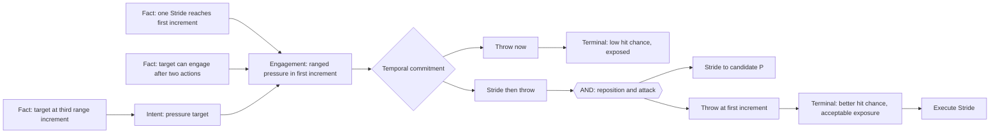

# Hierarchical planner and decision graph implementation blueprint

Status: Phase 1–3 runtime foundation implemented in version 0.48.0 following [Hierarchical combat decision architecture research](./hierarchical-decision-architecture-research-2026-11-26.md). The decision worker now produces doctrine, shared engagement analysis, a bounded intent portfolio, temporal classifications, component-backed methods and a versioned trace. Region-first tactical queries, abstract opponent responses and complete six-action search remain later phases; the graph does not claim those nodes yet.

## Design objective

Replace the current sequence of flat rankings with a real hierarchy of combat commitments, while preserving the working PF2e rules, actor-specific abilities, reaction pauses, native execution, and modular behavior catalogue.

The runtime must produce the hierarchy. The graph renderer must only display the versioned trace it receives.

## Current-to-target mapping

| Current concept | Current responsibility | Target responsibility |
| --- | --- | --- |
| Tactical plan | Mixes role, posture, delivery, movement, and situation | Split into doctrine traits, strategic intents, engagement generators, and methods |
| Behavior component | Generates or adjusts immediate candidates | Primitive provider, effect model, method fragment, spatial channel, or executor |
| Preferred/backup/desperate | Actor-authored global ordering | Doctrine prior plus fallback policy after search failure |
| Objective | One selected plan's immediate goal | Explicit desired end-state with subject, horizon, and success predicates |
| Action score | Immediate layer/value plus terms | Prefix estimate and terminal sequence value tied to a parent engagement |
| Decision record | Final action ranking | Full planning trace with analysis, hypotheses, decompositions, simulations, and pruning |
| Decision graph | Breadth-first pipeline view | AND/OR decision DAG, temporal plan lane, and spatial evidence view |

## Architectural modules

The names below are proposed boundaries, not committed filenames.

### `DoctrineProfile`

Cached, mostly statblock-derived feature vector:

- contributions: damage, control, support, defense, scouting, leadership;
- delivery: melee, ranged, area, single-target, save, attack;
- mobility: ground, climb, swim, flight, teleport;
- risk: durability, escape, resource conservation, aggression;
- authored personality and encounter role priors;
- available defining activities and spell families.

It replaces the assumption that an actor must be exactly one of “support,” “ranged,” or “close combat.”

### `CombatBeliefState`

Serializable worker input containing only actor-known or table-authorized information:

- self and ally state;
- known enemies and remembered positions;
- confidence and visibility state;
- legal resources and conditions;
- simplified geometry identifiers and cached spatial fields;
- turn and encounter state.

Secret outcome truth remains outside this object.

### `EngagementGraph`

A directed relation for every relevant actor pair and delivery family:

```js
{
  sourceId,
  targetId,
  deliveryId,
  affectNow,
  actionsToAffect,
  expectedEffect,
  targetCanAffectNow,
  targetActionsToAffect,
  exposure,
  pathCost,
  rangeBand,
  visibilityBelief,
  confidence,
  evidenceIds
}
```

The graph is computed once per planning epoch and incrementally invalidated when position, condition, HP, resource, visibility, or scene geometry changes.

### `StrategicIntentProvider`

Produces broad encounter needs, each with a coarse score and evidence:

```js
{
  id: 'control-approach',
  family: 'control',
  score: 7.4,
  success: ['enemy-route-cost-increased', 'self-not-immediately-threatened'],
  evidenceIds: ['fact-enemy-cluster', 'doctrine-control-0.8']
}
```

Mandatory directives are installed before these providers and bypass ordinary intent scoring.

### `EngagementGenerator`

Combines an intent, delivery family, target or group, desired end-state, and horizon. It uses the engagement graph to reject impossible combinations before spatial search.

The output is a hypothesis, not an action:

```js
{
  id,
  intentId,
  deliveryId,
  subjectIds,
  desiredState,
  horizon: 'now' | 'this-turn' | 'next-turn',
  coarseValue,
  confidence,
  evidenceIds
}
```

### `TemporalCommitmentProvider`

Creates the timing alternatives that are presently missing:

- exploit now;
- setup then exploit this turn;
- setup for next turn;
- hold/observe;
- disengage/switch engagement.

It estimates opportunity cost, disruption risk, resource timing, and retained setup value. Top alternatives continue into decomposition.

### `TacticalQuery`

Defines spatial success predicates and score channels for one engagement. It does not expose raw every-cell combinations to the higher planner.

```js
{
  hardFilters: ['reachable', 'line-of-effect', 'activity-actions-fit'],
  attractors: ['first-range-increment', 'cover-from-subject', 'ally-support'],
  repellers: ['melee-threat-next-turn', 'reaction-reach', 'pit', 'dead-end'],
  requestedRegions: 4,
  pointsPerRegion: 3
}
```

The query should first return regions, then representative points. Exact native path validation happens only for surviving points.

### `TaskMethodRegistry`

HTN-like compound task methods with explicit applicability and ordered children:

```js
{
  task: 'apply-ranged-pressure',
  id: 'move-then-two-action-cast',
  preconditions: ['one-action-position-exists', 'two-action-payoff-available'],
  subtasks: [
    { task: 'reach-casting-position' },
    { primitiveFamily: 'two-action-offensive-spell' }
  ],
  expectedEffects: ['target-damaged-or-controlled', 'caster-at-query-position']
}
```

Methods are reusable across creatures. Actor components supply primitive bindings, effect models, and special methods for unique activities.

### `SequencePlanner`

Bounded, utility-guided beam search over:

1. current turn actions;
2. a small abstract opponent response set;
3. next turn actions.

It preserves activity boundaries and returns complete timelines. It uses the worker for pure simulation and the main thread for Foundry document access and final native checks.

### `PlanExecutor`

Runs only the next primitive, records the result, and applies layered repair:

```text
primitive binding -> method -> tactical query -> engagement -> strategic intent
```

Higher layers remain valid until their success conditions or assumptions fail.

## Search protocol

### Stage A: prepare and cache analysis

Main thread:

1. snapshot Foundry/PF2e documents;
2. update doctrine profile when the actor or resources changed;
3. update belief state and engagement relations;
4. serialize the worker-safe planning state.

### Stage B: generate strategic candidates

Worker:

1. apply mandatory directives;
2. score strategic intents;
3. retain the best `K_intent` and anything within `intentBand` of the best;
4. generate engagement hypotheses from each survivor;
5. remove impossible engagements with cheap reachability and capability bounds;
6. retain `K_engagement` per intent and `K_global` overall.

Suggested initial bounds:

| Bound | Initial value |
| --- | ---: |
| `K_intent` | 3 |
| `intentBand` | 20% of best positive value |
| `K_engagement` per intent | 4 |
| `K_global` | 8 |
| temporal alternatives per engagement | 3 |

These are budgets, not game rules, and belong in profiler-visible settings.

### Stage C: decompose and spatially ground

For every surviving `(engagement, timing)` pair:

1. enumerate applicable methods;
2. reject methods whose minimum action/resource cost cannot fit;
3. request promising spatial regions;
4. bind representative positions, targets, and primitive providers;
5. produce complete current-turn skeletons before deeper simulation.

An activity is one primitive even when it costs two or three actions. The turn boundary rejects a skeleton if the full activity does not fit.

### Stage D: simulate and compare complete plans

Use beam search with state transposition:

```text
beam = grounded current-turn prefixes
expand until turn boundary
apply each relevant abstract opponent response
expand actor's next turn
merge equivalent abstract states
evaluate terminal states
```

The terminal score should include:

- expected damage and healing;
- action denial and condition value by expected duration;
- probability-weighted save, attack, flat-check, and resistance outcomes;
- end-position field value under the selected tactical query;
- counter-engagement exposure;
- ally opportunity and interference;
- resource and sustain opportunity cost;
- setup retained into the next turn;
- entertainment/doctrine terms already supported by the project;
- loop, dead-end, and repeated-failure penalties.

### Stage E: native validation and execute

Return a ranked shortlist to the main thread. Validate only the first complete plan's next primitive using current PF2e and Foundry APIs. If it fails, record the failure and try repair in increasing abstraction order.

## Top-K and score semantics

Each choice layer records:

- raw score;
- normalized score within its siblings;
- confidence;
- optimistic upper bound;
- evidence terms;
- status and prune reason;
- parent hypothesis IDs.

A layer may use different score units internally. Scores from different layers must not be displayed as directly comparable. Terminal grounded-plan values are comparable; a doctrine weight and an expected-damage score are not.

Randomness should occur only among terminal plans that:

- satisfy all mandatory constraints;
- lie in the highest priority layer;
- are within a configured quality band;
- do not violate an actor's hard doctrine;
- have no strictly dominating alternative.

## Planning trace contract

The graph needs a durable, versioned trace rather than inferred nodes.

```js
{
  schema: 'foundry-creature-ai/planning-trace@2',
  decisionId,
  actorId,
  combatId,
  turn,
  createdAt,
  beliefRevision,
  doctrineRevision,
  budget: { elapsedMs, expanded, pruned, cacheHits, workerMs, nativeMs },
  nodes: [{
    id,
    kind: 'fact' | 'constraint' | 'or' | 'and' | 'query' |
      'hypothesis' | 'method' | 'primitive' | 'simulation' | 'outcome',
    layer,
    label,
    status: 'considered' | 'survived' | 'selected' | 'pruned' |
      'failed' | 'repaired',
    score,
    confidence,
    detail,
    secret: false
  }],
  edges: [{
    id,
    source,
    target,
    relation: 'supports' | 'forbids' | 'refines' | 'decomposes-all' |
      'alternative-method' | 'binds' | 'simulates' | 'responds-with' |
      'selected' | 'repaired'
  }],
  timelines: [{ planId, turns: [{ side, primitives: [] }], terminalScore }],
  spatialQueries: [{ queryId, channels, regions, chosenPointId }],
  selectedPlanId,
  selectedPrimitiveId
}
```

The trace contains only serialized, bounded diagnostic data. Full heat maps and all rejected grid cells remain in profiler caches and are loaded on demand.

## Graph presentation

The debugger should have three linked views.

### Decision DAG

Horizontal semantic bands:

```text
Situation details
Legality and mandatory directives
Strategic intents
Engagement objectives
Temporal commitments
Atomic actions or compound methods
Compound method primitives
Competitive choice and outcome
```

AND nodes use a distinct shape and exist only for activities with more than one primitive. OR nodes show how many alternatives survived. State which is not instrumented as a causal score input stays in the situation node's details instead of becoming a decorative leaf. Candidate IDs are merged before display, and every displayed finalist converges on one competitive-choice node. Selecting a node exposes its recorded evidence and timeline.

### Temporal lane

Display action slots rather than a generic leaf list:

```text
Actor turn N      [Stride] [Cast spell: 2 actions]
Enemy response    [Close] [Strike]
Actor turn N+1    [Step] [Sustain] [Strike]
```

Multi-action activities span adjacent slots and never cross a turn divider. Uncertain branches can be collapsed under response nodes.

### Spatial evidence

Show only the selected query by default:

- hard-invalid cells;
- attractor and repeller channels;
- candidate regions;
- representative evaluated points;
- planned path and end point;
- target and counter-engagement envelopes.

This lets a GM distinguish a bad strategic choice from a good objective grounded to a bad square.

## Example trace

For a ranged ogre deciding whether to throw at a severe range penalty:



The range penalty is no longer an isolated negative term on Throw. The planner compares the complete “throw now” and “move then throw” branches, including the action cost, future range, counter-threat, and next-turn state.

## Migration plan

### Phase 1: honest trace layers

- Add stable IDs for facts, plans, components, candidates, and score terms.
- Record existing selection as `planning-trace@1` without changing behavior. This historical trace was replaced by causal `planning-trace@2` after the saved-tree audit found duplicated candidates and one-child method nodes.
- Teach the debugger to render typed nodes and edge relations.
- Keep the legacy graph available for comparison.

Exit criterion: every displayed node corresponds to recorded runtime reasoning; trace JSON round-trips deterministically.

### Phase 2: separate doctrine, facts, and intent

- Extract multi-label doctrine from current actor profiles and statblocks.
- Build the engagement graph from existing visibility, range, path, cover, condition, and target-memory services.
- Split current tactical-plan scores into intent providers and delivery facts.
- Retain top-K intent/engagement hypotheses.

Exit criterion: ranged, support, skulk, aerial, and caster traits can combine in one hypothesis; no actor needs one exclusive role label.

### Phase 3: method decomposition

- Define compound tasks and methods for shared PF2e patterns.
- Convert action components into primitive providers and effect models.
- Preserve special creature activities as registered methods.
- Enforce activity atomicity and turn-boundary constraints.

Exit criterion: the trace explains which complete activity bundle a movement action serves.

### Phase 4: tactical queries and six-action search

- Add context-specific position queries with region-first candidate generation.
- Add current-turn, response, and next-turn worker simulation.
- Add transposition keys, dominance pruning, time budgets, and partial results.
- Return terminal plan values and timelines.

Exit criterion: the planner can prefer setup with a demonstrable next-turn payoff and reject suicidal approaches whose immediate attack score looks attractive.

### Phase 5: layered repair and encounter coordination

- Persist the selected hierarchy across primitive actions.
- Repair at the lowest failed level.
- Add encounter needs, role bids, reservations, and synchronized payoffs.
- Surface repair and coordination in the debugger.

Exit criterion: a blocked square changes the path or method without discarding a still-valid group tactic.

### Phase 6: remove legacy flat selection

- Compare old and new decisions on recorded combat fixtures.
- Keep compatibility adapters for actor configuration.
- Remove flat tactical-plan selection only after equivalent core behavior and performance are verified.

## Verification strategy

### Structural tests

- every primitive has a parent method or mandatory directive;
- every selected node has a connected path from facts/directives to execution;
- every pruned node has a reason;
- AND children preserve order and action cost;
- no activity crosses a turn boundary;
- trace IDs are deterministic for identical inputs.

### Behavioral fixtures

- ranged actor moves out of a severe range penalty before attacking when safe;
- melee actor closes rather than choosing a weak ranged backup;
- short-range caster prepares defensively while enemies approach;
- skulk shoots from Hide without unnecessary Sneak when defense does not justify it;
- flyer reserves climb movement after a dive;
- support caster values ally timing and does not duplicate an active effect;
- Confused bypasses complex plans and follows its mandatory simplified policy;
- a failed destination repairs the method without losing a valid engagement;
- an actor with false stealth belief plans from that belief rather than hidden GM truth.

### Graph acceptance tests

- at least two alternatives survive beyond intent selection in a nontrivial fixture;
- shared evidence appears once and supports multiple hypotheses;
- a setup branch visibly decomposes into an AND bundle;
- a two-action activity occupies two temporal slots;
- selecting a grounded plan highlights its facts, engagement, timing, method, and immediate primitive;
- the graph never invents a layer absent from the planning trace.

### Performance evidence

Record separately:

- snapshot time on the main thread;
- engagement-analysis time;
- worker search time;
- expanded and pruned states;
- transposition and geometry cache hit rates;
- native-validation time;
- trace serialization size;
- time to first usable plan and time to final best plan.

The worker should return the current best complete plan when its budget expires. An incomplete deep branch must never make the actor wait forever.

## Implementation order recommendation

Begin with Phase 1 and Phase 2. They correct the conceptual model and make the debugger useful before the expensive six-action search lands. Then add methods for three representative families:

1. ranged pressure with move-versus-shoot timing;
2. short-range caster setup and payoff;
3. melee close, flank, and multi-action activity.

Those fixtures exercise role composition, target/counter-target analysis, timing, position queries, and activity atomicity. Once they are sound, unique monster abilities can plug into the same method and primitive contracts.
