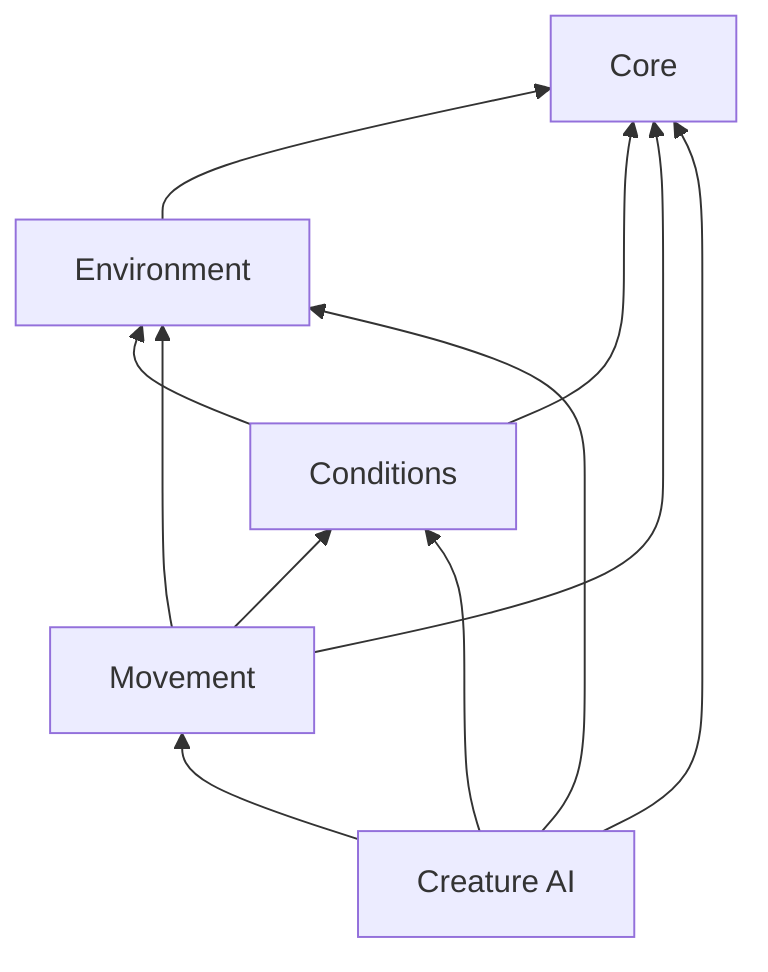

# PF2e Tactical Rules suite — 0.37.0

The release contains five Foundry modules. Manual rules remain available with Creature AI disabled. All packages use one shared reaction barrier and one contextual Check.roll wrapper, and every source module has exactly one installed owner.

| Module | Responsibility | Requires |
| --- | --- | --- |
| PF2e Tactical Rules — Core | Shared native rule library, service registry, API version 1, settings migration, roll pipeline and reaction synchronization | libWrapper |
| PF2e Tactical Rules — Environment | Cover/concealment zones, observer-relative captions, detection visibility, terrain and hazards | Core |
| PF2e Tactical Rules — Conditions & Spells | Action restrictions, recovery, supported lingering spells, poisons and external automation compatibility | Core, Environment |
| PF2e Tactical Rules — Movement | Native Step/Sneak choices, player Stealth, validated movement/reactions, Fly costs and falls | Core, Environment, Conditions |
| Foundry Creature AI | Profiles, tactical plans, worker search, pacing and automatic NPC turns | All four manual packages |

Install every folder from `pf2e-tactical-suite.zip` into Foundry's Data/modules folder. Restart Foundry once so it discovers the new packages, then enable the suite in Manage Modules; Foundry enforces declared dependencies. For manual play disable Creature AI while leaving the four Tactical Rules modules enabled. Reload all clients after changing modules. Individual module ZIPs are also included.

Native APIs are published on each module's `api` with `apiVersion: 1`. Core exposes active shared services under `game.modules.get('pf2e-tactical-core').api.rules`. The AI module consumes the same service objects and retains its legacy public API for existing NPC macros. It never registers manual mechanics hooks or creates a second reaction engine.

Shared library implementations are compiled into Core, while feature controllers own lifecycle registration, controls and installation of their mechanics. Native wrappers register under Core because libWrapper validates the first package frame against the implementation's package; a feature being disabled leaves its wrappers uninstalled. The build validates the complete import graph: no manual package imports AI profiles, planners, workers or adapters; cross-package imports must match declared dependencies. Disabling a feature removes its lifecycle/controller/API rather than copying or replacing another module's code.

Existing `foundry-creature-ai` document flags remain intact. Core registers that legacy data namespace with Foundry's flag-scope cache, so native flag APIs remain valid with AI disabled or absent. This loads no AI code and changes no document permissions. Shared settings migrate to their owning package; hidden legacy setting aliases preserve earlier callers. Native Region scripts generated by previous versions migrate only when they exactly match a known owned script. Custom scripts are not rewritten. Actor resource/reset macros remain in Creature AI.

## Flight and movement

Step, Sneak, [manual Ramp / stairs behaviors](ramps.md) and Fly costs are installed by Movement. Native Region behavior forms configure ramp elevations and uphill direction. The native ruler, actual movement, AI path validation and worker estimates use the same pure vertical-cost function for flight:

| Grid step | Cost |
| --- | --- |
| Level flight | Normal measured cost |
| Any ascent, including diagonals | At least twice the full measured distance; 5 feet costs 10, an expensive 10-foot diagonal costs 20 |
| Any descent, including diagonals | Half the normal cost; 10 feet costs 5 |

Higher native terrain costs and blocked movement remain authoritative. Existing descent discounts are not halved a second time. Blindness and region difficulty retain their native non-stacking terrain behavior. The requested full-step vertical multipliers apply consistently to AI and manual rulers.

Old releases and Git tags remain available for rollback. The installer backs up existing module folders before replacing generated files. World and actor documents are not reset during installation.
