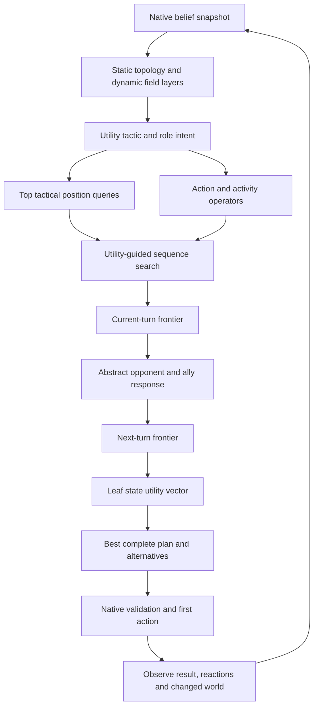

# Six-action tactical planner design

Status: proposed architecture; no implementation yet.

Research basis: [Multi-turn tactical combat planning](combat-planning-research-2026-11-26.md).

## Objective

Create one reusable planning engine that can choose coherent PF2e turns for melee, ranged, skulk, support, caster and flying creatures. At the start of a normal turn it reasons over up to six of that creature's own actions, separated by an abstract intervening battlefield response. It respects turn boundaries, native legality, imperfect information and Foundry responsiveness.

The planner should answer two questions together:

1. **What combat situation does this creature want?**
2. **Which legal sequence gets it there while producing useful effects?**

## Proposed pipeline



The planner produces a plan trace. The runtime executes only its first action. Re-planning after every resolved action is mandatory.

## Planning state

The worker needs a compact immutable `PlanningState` distinct from the Foundry snapshot's verbose diagnostic data.

```text
PlanningState
  phase: current-turn | response | next-turn
  actionsRemaining
  restrictedActions
  actor position, elevation, movement modes
  actor HP band, conditions, MAP, reaction availability
  held equipment, ammunition, spell/focus/resource bands
  sustained effects and once-per-turn markers
  known target beliefs and remembered positions
  ally beliefs and reserved targets/positions
  active tactic, target and position query
  field revision and geometry revision
  accumulated expected outcomes
  accumulated risks and resource costs
  sequence and explanation terms
```

Use bands where exact values do not change legality or scoring. Keep exact action budgets, positions, resource counts and once-per-turn markers because they affect available operators.

Unknown or secret facts remain distributions or existing beliefs. The transition model must never insert a hidden token's real square, secret check result, exact unknown defense or actual unseen HP.

## Operators

Every action provider should eventually expose a pure planning operator:

```text
Operator
  id and kind
  actionCost: integer 0..3
  mustFitTurn: boolean
  targets and destination bindings
  preconditions(state)
  transition(state) -> successor beliefs
  expectedOutcome(state)
  nativeChoice
  uncertainty markers
  explanation terms
```

`mustFitTurn` defaults to true. A two-action or three-action activity is rejected if its whole cost does not fit in the current phase. Internal Strikes inside Draconic Frenzy or Eagle Dive are part of that operator and do not become independent search edges.

Compound plans are separate from activities:

- `Reload → Strike` has two operators and can be interrupted between them.
- `Stride → Knockdown Strike → Knockdown` has three operators with conditional continuation after the Strike.
- `Hide → Sneak → Strike next turn` is a sequence with belief effects; it does not assume the secret checks succeeded.
- `Cast Fly → Fly out of pit` has a spell operator followed by movement operators.

Conditional steps use guarded continuations. When the condition is uncertain, the planner can value the expected continuation, but execution re-plans from the observed permitted knowledge.

## Tactics become intent generators

The existing tactic catalog should stop gating one current action and instead produce a `TacticalIntent`:

```text
TacticalIntent
  id
  target policy
  position query recipe
  allowed operator families
  preferred action bundles
  terminal evaluation weights
  opponent risk posture
  commitment and abandonment conditions
```

Examples:

- **Ranged engagement:** acquire a clear first-increment lane, preserve an escape route and attack.
- **Charge:** enter melee with enough remaining budget for a valuable attack or control activity.
- **Hiding:** reach protection, Hide when useful and preserve a next-turn attack lane.
- **Spell control:** reach a safe casting origin whose area or target geometry produces meaningful control.
- **Avoiding:** leave threat envelopes and end with multiple safe exits.
- **Swarming:** reserve distinct adjacent squares that produce flank or isolate a target.

Preferred, backup and desperate tactics become separate search roots. The best plan can come from a backup when the preferred intent has no sufficiently valuable complete sequence.

## Spatial layer system

Replace the single tactical `positionValue` with named arrays over a shared grid. A layer contains normalized values and provenance.

### Base layers

```text
topology/passability
movement cost by mode
surface and elevation legality
ally occupancy and reservation
hazard/control cost
known enemy occupancy probability
enemy arrival by actor
enemy melee threat by actor
enemy ranged exposure by actor and direction
cover/concealment by threat direction
own attackability by target and attack family
flank opportunity and flank exposure
safe-space size and exit count
AoE enemy density and ally density
recent visitation/reversal
```

### Recipes

A recipe combines layers with normalized response curves. It may contain hard filters and soft weights.

```text
RangedLane(target):
  require reachable
  require own line of effect to target
  prefer distance in [0.35, 0.85] of first range increment
  prefer directional cover from other ranged threats
  prefer two or more safe exits
  repel target melee arrival <= 1 action
  repel flank exposure
  repel firing through target cover
  repel route reaction and hazard cost
```

```text
SkulkAttack(target):
  require reachable
  require cover or concealment from at least one relevant observer
  prefer a valid attack lane from the endpoint or one action away next turn
  prefer breaking observation without losing target access
  prefer safe escape connectivity
  repel open squares and redundant stealth setup
```

```text
CasterControl(spellFamily):
  require affordable casting geometry this turn or next
  prefer enemy area density minus friendly-fire density
  prefer no manipulate reaction exposure
  prefer line of effect and directional cover
  prefer distance from one-action melee interception
  repel positions that require all actions but produce a weak cast
```

The worker returns the top points from distinct spatial basins, not simply the top adjacent cells. Two points belong to the same basin when they have nearly equal field terms and connect without crossing a meaningful score valley. This gives the sequence search tactically different choices.

## Candidate generation

The largest branching factor comes from grounding movement and targets. Use a staged generator.

### Stage 1: tactic skeletons

Each intent emits a small set of plan shapes:

```text
attack × remaining actions
move-to-position + attack/activity
setup + attack/activity
attack/activity + disengage
defensive setup + hold
two-turn setup | response | payoff
```

### Stage 2: bind meaningful targets

Keep the best few targets per role reason: easiest useful attack, highest threat, group focus target, isolated target, vulnerable caster and current persistent target. Do not bind every action to every opponent before pruning.

### Stage 3: bind positions

Query the top spatial basins for the skeleton's role. Validate only those endpoints with expensive native geometry.

### Stage 4: bind concrete operators

Create actual Strike, spell, activity, movement and setup operators. Deduplicate equivalent states even when different action orderings reach them.

## Search algorithm

Start with deterministic utility-guided beam search.

```text
frontier = seed plans from preferred, backup and desperate intents
bestComplete = safe immediate fallback

for each temporal phase:
  while phase has action budget and node budget remains:
    expand each frontier state with legal operators
    reject activities that cross the turn boundary
    apply pure transitions and accumulate terms
    merge identical abstract states
    remove dominated states
    rank by accumulated value + heuristic upper estimate
    retain diverse top K states
    update bestComplete

  if crossing from current turn:
    apply bounded opponent/ally response models
    reset own ordinary action budget to 3

return bestComplete plus alternatives and trace
```

Recommended initial bounds:

| Bound | Initial value | Purpose |
| --- | ---: | --- |
| tactical intents | 3 | preferred, backup, desperate |
| targets per intent | 3 | keep target diversity |
| position basins per query | 4 | avoid nearly identical cells |
| beam width | 24 | enough tactical diversity without large clone traffic |
| successor operators per node | 12 | action abstraction gate |
| opponent scripts | 2 | expected and adverse plausible response |
| node budget | 4,000 | deterministic work cap for initial experiments |
| safety deadline | 1,000 ms | prevent pathological worker stalls |

These values require benchmarks. The planner should adapt depth: if it cannot complete a strong current-turn beam within budget, it should reduce opponent branches or next-turn width rather than returning no decision.

## Successor-state evaluation

Keep a structured `UtilityVector` until the final ranking:

```text
effect:
  expectedDamage
  expectedHealing
  expectedControl
  actionDenial
position:
  roleComfort
  attackAccess
  protection
  mobility
  teamGeometry
risk:
  expectedIncoming
  reactionExposure
  hazardExposure
  controlExposure
economy:
  actionsSpent
  limitedResourcesSpent
  MAPWaste
plan:
  objectiveProgress
  nextTurnReadiness
  stability
  repetition
style:
  abilityShowcase
  tankExperience
  personality
```

The scalar score is a tactic-specific projection of this vector. Store both. A huge damage number cannot hide that a move is illegal; hard legality is outside utility. Likewise, entertainment weights should influence close alternatives rather than erase obvious tactical consequences.

Terminal evaluation should reward **opportunity retained**: number and quality of useful plans available next turn. This prevents a locally high attack from leaving the actor trapped, unable to see anyone, or unable to use its defining activity.

## Opponent response transition

The response phase is not a complete simulated round. It predicts how exposed the planned endpoint is before the actor acts again.

For each known opponent, derive a role from observed attacks, movement and recent behavior, then apply one of these scripts:

1. `pressure`: shortest safe approach to a useful attack/control envelope;
2. `hold`: attack or cast from the current effective position;
3. `disengage`: improve protection or distance when threatened.

Aggregate actors by the threats they can apply to the planned endpoint. The transition estimates incoming pressure, likely cover compromise, likely adjacency/flank and target displacement bands. It does not select actual dice results.

Use two aggregate branches initially:

- **expected response**, weighted by observed roles;
- **adverse plausible response**, the strongest legal pressure the actor reasonably knows about.

Rank plans by expected value minus a configurable fraction of adverse regret. This makes cautious casters and skulks respect danger without turning every creature into a perfect minimax player.

## Receding-horizon execution and repair

Persist the selected plan as an intention, not as an instruction queue.

After every action:

1. native execution finishes, including reaction prompts and movement interruption;
2. build a fresh belief snapshot;
3. test the saved plan's assumptions and next operator preconditions;
4. seed the new search with the repaired remainder;
5. compare it with newly generated plans;
6. retain it only when still competitive.

This gives continuity without blindness. Plan abandonment reasons should be explicit: target moved, line lost, activity no longer fits, resource spent, condition changed, ally occupied destination, reaction stopped movement, expected outcome became known, or a substantially better opportunity appeared.

## Group coordination

Individual planning can still create traffic jams and duplicated targets. Add a lightweight encounter coordinator after individual planning works.

- Reserve planned destination footprints through the next action.
- Reserve scarce tactical roles such as “flank square,” “block lane,” and “AoE center.”
- Publish target pressure so another actor can avoid pointless overkill or deliberately focus fire.
- Plan actors in initiative order and allow later actors to consider earlier reservations.
- Invalidate reservations when execution diverges.

This is coordination metadata, not shared omniscience. An actor receives only reservations and facts its side is allowed to coordinate.

## Worker and Foundry split

### Main thread

- collect native actor/item/action data;
- build belief-safe target records;
- maintain static grid topology and scene revisions;
- run native collision, visibility, cover, Region and movement checks for shortlists;
- validate and execute the first chosen action;
- handle rolls, chat, reactions, resources and effects.

### Worker

- combine tactical field layers;
- generate role recipes and position basins;
- instantiate pure operator transitions;
- run beam search and opponent transitions;
- evaluate utility vectors;
- construct the complete diagnostic trace.

The worker payload should use compact numeric tables and indices. Scene topology can be sent once per revision, followed by smaller dynamic updates, rather than cloning the entire nested state for every re-plan.

## Integration with the current code

| Current module | Proposed responsibility |
| --- | --- |
| [`decision-engine.mjs`](../src/framework/decision-engine.mjs) | Orchestrate tactic roots and invoke the sequence planner instead of final one-action ranking |
| [`behavior-system.mjs`](../src/framework/behavior-system.mjs) | Produce tactical intents, weights and abandonment conditions |
| [`tactical-field.mjs`](../src/framework/tactical-field.mjs) | Become the low-level grid/influence library with named layers |
| [`activity-plan.mjs`](../src/framework/activity-plan.mjs) | Supply indivisible activity operators and turn-boundary constraints |
| [`decision-snapshot.mjs`](../src/foundry/decision-snapshot.mjs) | Serialize compact belief state and operator facts |
| [`decision-runtime.mjs`](../src/foundry/decision-runtime.mjs) | Cache topology revisions, request plans, detect staleness and revalidate first actions |
| [`chooser.mjs`](../src/dawnsbury/chooser.mjs) | Remain the immediate fallback and contribute action-ordering heuristics |
| [`decision-graph.mjs`](../src/foundry/decision-graph.mjs) | Display temporal search, field terms, pruning and plan repair |

Existing creature-specific forecasts should become operator effects or tactic skeletons one at a time. Keep compatibility until each profile produces equivalent native choices through the new planner.

## Decision debugger design

Add three synchronized views.

### Plan timeline

```text
current turn                     response                    next turn
[Stride 1] [Knockdown Strike 2] | [fighter pressures lane] | [Strike 1] [Knockdown 1] [Step 1]
```

Each node shows remaining actions, predicted state changes, expected value, risk and preconditions. Activities occupy one node with their complete cost.

### Search tree

Show the retained beam and sampled pruned branches. Nodes indicate:

- tactic and target;
- cumulative and heuristic score;
- dominance/transposition merges;
- boundary rejection;
- beam cutoff;
- opponent response branch;
- selected plan and alternatives.

### Tactical field

Select any position recipe and display its combined heat map. Clicking a cell lists every attractor, repeller, hard filter and native validation result. Selecting a search node updates the map to that successor state.

## Verification strategy

### Pure planner tests

- a two-action activity never crosses a boundary with one action remaining;
- a three-action activity is planned for the next turn only after valid setup;
- the planner accepts a lower immediate attack when it creates a stronger next-turn state;
- ranged actors prefer a clear first-increment lane with escape space;
- melee actors enter reach only when the remaining budget enables the intended payoff;
- skulks prefer cover adjacent to an attack lane and do not Hide redundantly;
- casters choose safe high-value spell origins and avoid friendly fire;
- equivalently useful action orders merge;
- dominated plans prune deterministically;
- fixed seeds and node budgets produce repeatable traces;
- secret results and unseen coordinates never enter the planning state.

### Native integration tests

- top position endpoints survive Foundry collision and wall checks;
- a rejected endpoint falls back to another basin without rebuilding everything;
- reactions and stopped movement invalidate the remainder before another action is spent;
- resource and MAP changes match native execution;
- persisted plans repair after target movement, death and condition changes;
- the interface heartbeat continues during the entire search.

### Tactical scenarios

Create small saved fixtures with expected qualitative outcomes rather than one exact action ID. Each fixture defines acceptable plan families, forbidden failures and performance limits. Then run seeded encounter batches comparing the current greedy planner and the proposed planner.

## Migration stages

1. **Planner kernel:** state transitions, action budgets, activity boundaries, utility vectors and beam search on pure fixtures.
2. **Spatial query engine:** named field layers, recipes, basin selection and debugger heat maps.
3. **Current-turn planning:** migrate basic melee/ranged actors and remove their local one-step movement forecasts.
4. **Two-turn horizon:** add response scripts, next-turn evaluation and plan repair.
5. **Complex activities:** migrate Eagle Dive, dragon activities, reload/equipment and condition follow-ups.
6. **Casters and skulks:** migrate spell scenarios, Hide/Sneak beliefs, area targeting and sustain planning.
7. **Group coordination:** destination and role reservations in initiative order.
8. **Tuning and rollout:** tactical vignette regression, encounter batches, live latency profiling and versioned behavior defaults.

No stage should remove the existing one-action fallback until the new planner has a bounded failure path and equivalent native validation.
