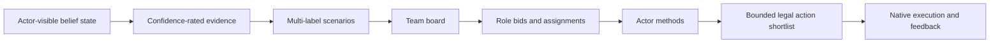

# Tactical scenario runtime

Version 0.55.0 implements the battlefield-state architecture described in [the tactical scenario research](tactical-scenarios-and-battlefield-state-research-2026-11-26.md). The planner no longer treats a flat collection of tactic scores as its interpretation of combat. Actor-visible evidence now produces simultaneous scenario hypotheses; a team board selects objectives, assigns roles, reserves lanes and effect budgets; actor plans then ground those assignments into legal PF2e actions.

## Runtime pipeline

The code is split by responsibility:

- `battlefield-state.mjs` builds engagement relations, aggregate metrics, and evidence. Evidence records include scope, source/provenance, confidence, observation revision, age, expiry, related scenarios, and explicit thresholds where a numeric boundary exists.
- `tactical-scenarios.mjs` recognizes compatible scenario hypotheses. A scenario has separate entry and exit thresholds plus a small continuity bonus, so marginal changes do not cause plan thrashing.
- `team-coordinator.mjs` builds a serializable team board from information available to that team. It records a stable frontline, formation components, force ratio, active objectives, actor role bids, assignments, lane reservations, and useful-effect budgets for targets.
- `behavior-system.mjs` treats existing plan IDs as methods under the selected scenario and assignment. An assignment strongly favors its preferred method but ordinary legality and emergency directives still win.
- `hierarchical-planner.mjs` grounds the surviving methods and emits `planning-trace@3` as the only source for the decision debugger.

The Foundry runtime and headless combat lab use the same modules. The Foundry adapter excludes unknown enemy positions before coordination. A Hidden enemy may contribute its known square; an Undetected enemy never contributes its live canvas position.

## Current scenario catalog

The actor-level catalog recognizes contact, opening ambush, distant melee approach, ineffective ranged distance, protected firing line, ranged pressure, isolated targets, swarming, formation recovery, screening, hostile and friendly area geometry, hold/breach choke, dead-end escape, vertical mismatch, burst windows, resource conservation, advantage, and fighting withdrawal.

Several scenarios may remain active at once. They supply evidence and compatible methods; they do not each command every actor. The coordinator currently gives specialized team assignments for:

- opening ambush;
- protected firing lines;
- alternating withdrawal and rear guard;
- distant melee charge lanes;
- formation recovery;
- focused engagement with an overkill budget.

Other scenarios already influence actor method selection and appear in the trace. Their richer team roles and semantic position queries can be added without changing the evidence, scenario, assignment, or action interfaces.

## Coordination policy

Role bids record capability fit, position fit, initiative timing, resource fit, travel cost, commitment cost, risk, conflict, and total. Staggered ranged withdrawal compares `withdraw` and `rear-guard` bids for each actor. Assignments include the winning bid and preferred/fallback plans.

Lane reservations use the team's frontline direction and a perpendicular lane projection. Candidate movement receives a bounded bonus for following its assigned lane. Reservations expire with the board revision and are recomputed after material action changes.

Target engagement budgets estimate useful expected effect. Once reserved effect reaches 120% of expected HP, extra actors become reserves instead of blindly dog-piling. Native execution may still invalidate a reservation; the next action rebuilds the board from the resulting state.

An opening ambush is completed per actor. Contact or allied success cannot cancel a scout's prepared Hidden shot. Once every relevant scout has spent or lost that opportunity, pressure scenarios may assign kiting and rear-guard roles.

## Decision graph

`planning-trace@3` has this causal order:

1. doctrine and allowed knowledge;
2. battlefield evidence and engagement relations;
3. active scenario hypotheses;
4. selected team objective;
5. actor assignment and its competing bids;
6. PF2e legality and action budget;
7. surviving actor methods;
8. objective, timing, activities and primitive actions;
9. competitive choice and execution result.

Rejected grid cells remain summarized. The graph displays a bounded semantic action shortlist rather than turning every map square into a leaf.

## Verification boundary

The 300-by-300-foot six-ogre versus six-kobold fixture verifies the first coordinated slice. Every kobold prepares and spends an opening Hidden attack before switching phase; pressured ranged actors alternate movement and rear-guard roles in distinct lanes; melee-primary ogres receive charge assignments; target budgets prevent universal focus; and all targets remain hostile-team actors.

This release establishes the reusable architecture. Exact cell reservations, sector search allocation, screen/peel bidding, choke access capacity, objective interaction, and specialized vertical/water team roles remain future scenario modules. The runtime exposes the data and trace points needed for those additions without restoring the former flat situation-to-tactic bridge.
