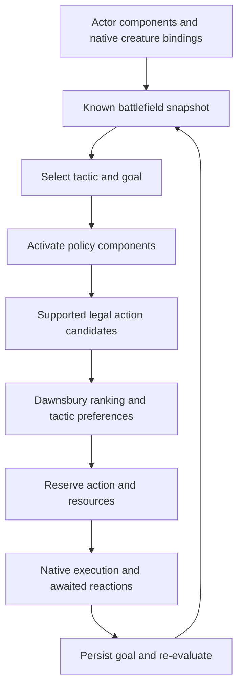

# Tactical plans and behavior components — 0.28.3

The runtime now separates **what a creature can do** from **what it is trying to achieve**. The design uses actor data, reusable components and shared systems, while retaining native PF2e bindings and specialized forecasts for complicated creatures. This plan layer is a Foundry implementation of the requested architecture, not a claim that these eight tactics were extracted from Dawnsbury Days.



## Plan selection

| Tactic | Typical opportunity | Goal |
| --- | --- | --- |
| Aggressive | A useful attack is available | Engage a known opponent |
| Charge | Melee needs a safe approach and local numbers permit it | Close to effective reach |
| Defensive | Short-range caster, injury or unfavorable local numbers | Keep protection while remaining able to fight |
| Avoiding | Critically low own HP or broken morale | Disengage from known threats |
| Kiting | Usable ranged attacks, approaching melee and visible ally support | Maintain a useful range |
| Hiding | Useful protection, no immediate attack, or an existing hiding belief | Break observation or retain the estimated advantage |
| Swarming | Known allies can surround an isolated opponent | Coordinate a surround |
| Supporting | An implemented enabling action can benefit allies | Enable those recipients |
| Aerial hunt | A prepared melee Strike and usable flight | Build altitude, stage a complete attack-and-escape pass, then recover |
| Lay low | All known enemies remain above available attack reach, with no supported ranged response | Take protection, Hide and Sneak defensively, then hold |

Selection uses the actor's own health/resources, known enemy positions, observed weapon roles, visible allied combatants and opportunities supplied by its bindings. It does not use actual enemy AC/saves or secret Stealth results. Counts are a local estimate, not a simulation of the encounter's true strength.

Each selected plan has an explicit goal object, suitability score, reason and active component set. Engagement goals can retain a target when it remains known and comparably accessible. Losing that target causes retargeting. A small continuity preference reduces switching between nearly equal plans; critical danger removes it. A configured preference helps only when the plan is applicable. Goals are re-evaluated after actions and interruptions rather than committed as an uninterruptible sequence.

Flight-capable actors also receive Aerial hunt in their default plan list. Its phase and preferred elevation appear in the goal and explanation. Shared melee attack gating still requires an affordable escape even if an explicitly configured plan favors aggression. Creature-specific activities, such as Eagle Dive, supply their own native activity cost and endpoints to the shared flight route planner.

Lay low uses observed or remembered elevations rather than live unseen coordinates. It has no arbitrary hiding timeout while the opponent remains unanswerable. Defensive Sneak is valued for increasing the estimated Undetected chance, including a move between equally protected squares; repeated Sneaks that no longer improve that advantage are suppressed. Ordinary Hide/Sneak legality, half Speed and separate secret resolution still apply. Mindless defaults retain their existing engagement plans.

## Complete activity goals

`framework/activity-plan.mjs` budgets an ordered sequence of native steps. A binding can provide `state.activityGoal = {kind: 'eagleDive'}` and a candidate's `features.turnPlan`, constructed with `activityPlan({id, label, steps, value})`. Each step declares its own action cost; the sum must fit the remaining turn before the preferred first step is preserved. Plans with no positive benefit cannot monopolize selection. Critical danger and broken morale release the preference, and recovery/perception remain available. The runner still reserves and executes only the current native step and re-evaluates afterward.

Eagle Dive binds this shared mechanism to Dive → escape Fly. Atomic movement cannot consume its first action when the complete useful activity is ready. Earlier setup forecasts position the Eagle for a future full turn. Other creature bindings can reuse the same goal mechanism; their native legality, resources, effects and continuation forecasts still need to be supplied. Existing caster forecasts are retained rather than automatically treating every multi-action spell as a preferred activity.

Hiding does not repeatedly reroll an unsuccessful secret check: the actor keeps its estimated belief. It also does not stall sight-blocked pursuit merely because a wall already prevents observation. Two quiet hiding turns, or the caster's existing setup timeout, permit engagement again. Avoiding creates native legal retreat options and suppresses immediately advancing back toward the same threats. Existing pack-morale exits retain their own route policy.

## Components and shared rules

Attached ability components cover recovery, perception, prepared Strikes, movement, combat control, equipment, stealth, spellcasting, leadership and pack coordination. Available native data determines which actions they can actually supply. A component name does not grant a weapon, spell, reaction or monster ability.

Plans activate policy components such as pressure, advancing, protection, distance, surrounding, assisting and withdrawing. Learned abilities remain available as legal fallbacks; essential recovery/perception and basic action components cannot be removed through a tactic preference. Selected goals can reject an inappropriate move, such as abandoning a hiding position for an exposed advance.

Reusable rules now include:

- Stand, configured Escape and Seek candidate providers with shared native execution.
- Prepared Strike candidates, MAP and targeting geometry; generic/Pyro melee execution shares targeted flat checks, native damage/IWR and Shield Block waits.
- One native Hide implementation used by scouts, Pyros and other attached actors.
- One native Sneak implementation, including half Speed or Swift/Legendary Sneak, observer geometry, secret resolution before movement, normal movement/reaction barriers and separate estimated beliefs.
- Protected-position movement and bounded disengagement candidates usable outside the original scout/caster profiles.

Specialized kits still add their own mechanics and forecasts: Pack Attack/Knockdown, hook follow-ups, command, finite missiles, reloads, Scuttle and the taught spell list. These use shared execution where applicable. Reusing a general rule does not automatically implement every unique action printed on an actor.

The **Basic NPC** fallback recognizes unfamiliar NPCs with valid prepared native melee Strikes. It binds melee reach, MAP, damage, ground movement, recovery, perception and shared stealth. Its additional actions, ranged ammunition configurations and arbitrary spells are listed for manual handling. Unsupported movement, effects or action restrictions retain the existing guards.

## Using and configuring it

Reload all clients with **Ctrl+F5**. The runtime factory applies the layer automatically. Use **Alt+W → Tactics / behaviors** to inspect the last plan and choose a preference. **Last decision** shows the selected goal, active components and alternatives under **Why this tactic?** The submenu retains the compact scrollable layout.

Configuration lives in `flags.foundry-creature-ai.behaviors` on an actor or token. Token fields override inherited actor fields. Saving a token preference does not freeze the actor's component list. Temporary plan/Hiding-attempt history is separate, scoped to the combat and scene, and cleared by prototype reset; configuration is preserved. Previews do not persist plans.

For example, as the active GM:

```js
const ai = game.modules.get('foundry-creature-ai').api;
const token = canvas.tokens.controlled[0];

// This token's preference, retaining inherited components.
await ai.behaviors.configure(token.document, { preferredPlan: 'defensive' });

// An actor configuration inherited by its tokens unless overridden.
await ai.behaviors.configure(token.document.baseActor ?? token.actor, {
  plans: ['aggressive', 'defensive', 'avoiding', 'hiding'],
  preferredPlan: null
});

ai.behaviors.inspect(token); // Effective configuration and last persisted plan.
ai.behaviors.catalog();      // Registered component and plan identifiers.
```

`components` and `plans` are ID arrays; `parameters` is JSON data keyed by component ID. Unknown identifiers, non-data parameters and excessive parameter payloads are rejected. Core components are retained. No JavaScript in an actor description or flag is evaluated.

## Adding behavior once

Registered module code can use `api.behaviors.registerComponent` and `registerPlan`. A component can supply:

| Hook/data | Responsibility |
| --- | --- |
| `id`, `kind`, `actionKinds` | Stable identity, ability/policy classification and action ownership |
| `enrich(state, adapter, parameters)` | Add supported native availability and knowledge-safe estimates |
| `candidates(state, selection)` | Offer actions with explicit costs, legality and scoring terms |
| `adjust(candidate, state, selection)` | Add a tactical preference; the aggregate adjustment is bounded |
| `execute(adapter, choice, ledger, context)` | Await the native handler for a newly taught action |

A plan supplies `id`, `label`, active policy `components`, optional required components, a suitability callback and an optional objective callback. Attach the registered IDs to actors through the configuration API. An extension must load its registered code each session before those actors act; serialized actor data stores no function bodies.

All actions still pass the shared affordability/legality gate, revalidation and reaction barriers. A detached component cannot execute a stale choice. Recovery priorities and negative-risk options are not made attractive by a tactic bonus. Teaching an unsupported spell or special action requires a real native handler and tests; changing the active plan alone cannot execute it.

Regression coverage includes plan selection/switching, continuity, goals, component gating, budgets, persistent scopes, configuration inheritance, secret-result independence, native generic attacks, shared Hide/Sneak and the existing creature/reaction suite. No live arena battle was rerun for this architectural change.
